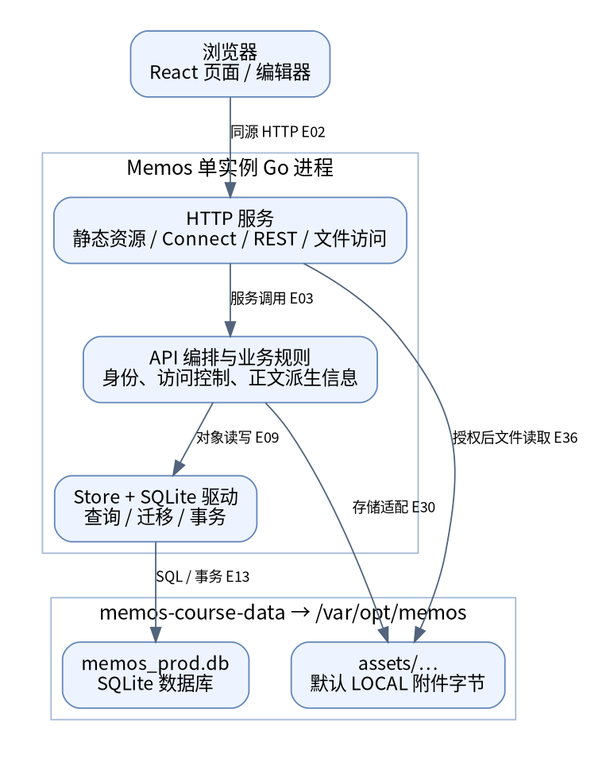
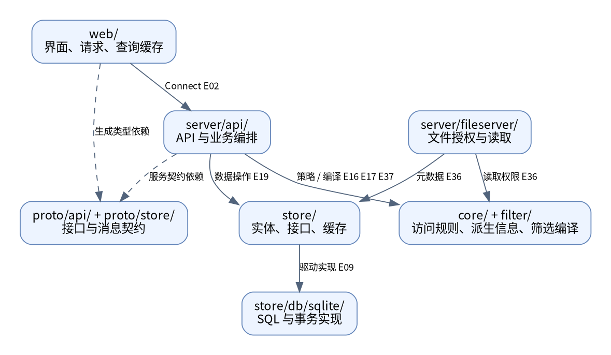
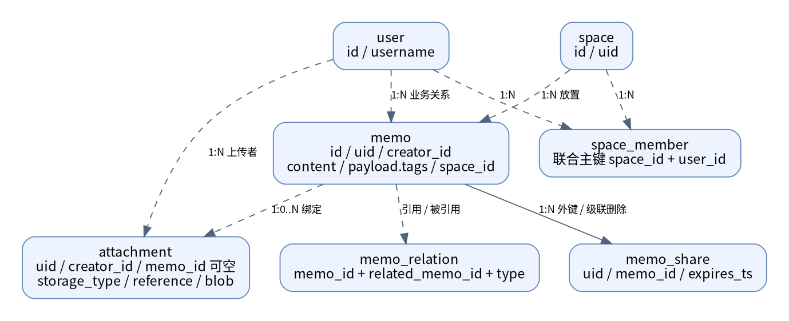

# 部署与架构

**负责人：张凯硕**
**文档更新：2026-11-28**
**范围：部署方案、整体架构、模块依赖、主要数据对象及跨模块核对；第二阶段系统模型整合见文末。**

## 1. 统一运行环境

| 项目 | 约定 |
| --- | --- |
| 上游 | usememos/memos |
| 阅读与部署版本 | 26.11.0 |
| 完整源码提交 | `b40d8a7b573774c52b022c8d6537d6baf2129dc0` |
| 部署方案 | Windows 11、Docker Desktop Linux 容器、PowerShell |
| 实例与数据库 | 本地单实例，默认 SQLite |
| 本机入口 | `http://127.0.0.1:5230` |
| 持久化 | `memos-course-data:/var/opt/memos` |

以上是课程统一部署方案。成员已归档的实际环境分别保留在各 UC 报告中，不能把 macOS 原生运行的 8081/15230 端口改写为 Docker 的 5230。源码核对日期为2026-11-28。

## 2. Windows 部署步骤

启动 Docker Desktop，在 PowerShell 获取指定源码及同版本镜像。

```powershell
git clone --branch 26.11.0 --depth 1 https://github.com/usememos/memos.git memos-source
git -C memos-source rev-parse HEAD
docker pull ghcr.io/usememos/memos:26.11.0
docker run -d --name memos-course -p 127.0.0.1:5230:5230 -v memos-course-data:/var/opt/memos ghcr.io/usememos/memos:26.11.0
```

打开 `http://127.0.0.1:5230` 并创建课程测试账号。保存一条含 `#se` 的笔记，刷新、重新打开，再重启容器检查内容持久化。详细功能结果归入 UC-01、UC-02。

```powershell
docker start memos-course
docker restart memos-course
docker logs --tail 100 memos-course
Invoke-WebRequest -Uri http://127.0.0.1:5230/healthz -UseBasicParsing
```

已有容器使用 `start`，重复 `run` 会产生同名冲突。启动异常时检查 Docker、端口占用、容器名称和卷挂载，再看日志。容器由 `MEMOS_PORT=5230` 设置端口，原生命令行默认8081。[E04] [E05] SQLite默认文件为数据目录下的 `memos_prod.db`。[E06] `/healthz` 只在数据库 Ping 成功时返回200与 `Service ready.`，失败返回503。[E07]

| 部署检查 | 预期 |
| --- | --- |
| 源码与镜像 | 固定提交及26.11.0标签一致 |
| 首页与就绪检查 | 资源可加载，健康接口200 |
| 端口 | 仅发布本机回环地址5230 |
| 持久化 | 刷新和重启后已保存笔记仍可读取 |

## 3. 整体运行架构



浏览器通过同源 Connect 调用服务。[E02] Go 单进程同时提供API、前端静态资源与附件文件路由。[E03] [E07] [E08] [E36] Store 选择 SQLite 驱动，在进程内执行 SQL，浏览器不直接连接数据库。[E09] [E13]

默认附件存储为 LOCAL，路径模板是 `assets/{timestamp}_{uuid}_{filename}`；相对路径相对于 `Profile.Data`。在本方案中，数据库及默认附件都位于命名卷中。[E30] [E38] 选择 DATABASE 时字节进入 attachment.blob；选择 S3 时字节在对象存储，命名卷不会替代 S3 备份。SQLite数据库类型不能证明某个成员实例实际采用何种附件存储。

## 4. 模块职责与依赖



| 模块 | 职责 | 关系与依据 |
| --- | --- | --- |
| `cmd/memos/`、`internal/profile/` | 读取配置、验证数据目录、迁移及启动 | 组装驱动、Store、Server；[E05] [E06] |
| `web/` | 页面、编辑器、筛选及分享交互、请求与缓存 | Connect客户端调用API；[E02] [E14] [E15] |
| `server/`、`server/frontend/` | HTTP入口、健康检查和静态资源 | 同一服务发布网页与API；[E07] [E08] |
| `server/api/` | 请求转换、身份上下文、业务编排 | 调用core、filter与Store；[E03] [E10] [E28] |
| `core/access/`、`core/memopayload/` | 访问策略与正文派生信息 | 判断读取权限、提取标签及属性；[E16] [E17] |
| `filter/` | 筛选表达式与方言SQL编译 | 编译关键词、日期与标签条件；[E37] |
| `store/`、`store/db/sqlite/` | 实体、缓存、接口、SQL与事务 | 驱动实现数据读写及附件绑定事务；[E09] [E19] [E34] |
| `server/fileserver/` | 文件内容访问 | 获取元数据、校验访问、按存储类型读文件；[E36] |
| `proto/api/`、`proto/store/` | API和内部数据契约 | 生成前后端消息类型；[E24] |

### 五条功能流程的架构对应

| 功能 | 核心数据流 | 源码证据 |
| --- | --- | --- |
| UC-01 新建与编辑 | 编辑器/查询hooks → CreateMemo或UpdateMemo → 正文与附件准备 → Store事务 → memo | [E10] [E14] [E28] [E34] |
| UC-02 标签分类 | 正文 → memopayload → memo.payload.tags；筛选条件 → ListMemos → SQL | [E17] [E24] [E35] [E37] |
| UC-03 搜索与日期 | 前端筛选 → ListMemos → filter编译 → Store/SQLite查询 | [E35] [E10] [E13] [E37] |
| UC-04 附件 | uploadService → UploadAttachment → 内容存储及attachment记录；笔记保存另行绑定；查看走文件服务 | [E29] [E33] [E30] [E21] [E28] [E36] |
| UC-05 分享 | useCreateMemoShare → 分享服务/访问策略 → memo_share；GetSharedMemo验证令牌再读取目标笔记 | [E15] [E31] [E16] [E20] |

本表仅用于合图和依赖核对；各UC的详细操作、测试结果、标注与风险分析由其负责人维护。

## 5. 主要数据对象与关系



实线标出数据库外键；虚线是业务关联，并不表示SQLite中声明了外键。

| 业务概念 | 实际表/字段 | 关系 |
| --- | --- | --- |
| 用户 | `user` | id主键、username唯一，保存password_hash |
| 笔记 | `memo` | id为内部主键，uid为资源标识；creator_id关联作者，space_id可空 |
| 标签 | `memo.content`、`memo.payload.tags` | 正文派生概念；没有独立tag/memo_tag表 |
| 附件 | `attachment` | creator_id标识上传者，memo_id可空；storage_type、reference、blob区分保存位置 |
| 分享 | `memo_share` | uid为分享标识，memo_id关联目标笔记；expires_ts可空；该外键声明ON DELETE CASCADE |
| 空间及成员 | `space`、`space_member` | 成员以(space_id,user_id)为联合主键 |
| 笔记关系 | `memo_relation` | (memo_id,related_memo_id,type)唯一；关联不授予读取权限 |
| 设置 | `system_setting`、`user_setting` | 实例配置与用户设置 |

表结构证据为[E32]。附件移除不是简单置空memo_id：绑定与移除经存储事务处理，删除附件行后再清理外部文件。数据库事务和本地/S3文件删除并非同一原子事务。[E28] [E34] 分享是独立授权记录，不把原笔记自动改为PUBLIC，也不沿笔记关系扩大授权。[E16] [E31]

## 6. 跨模块核对与合图检查

- 版本、端口、数据目录分别区分源码默认值与部署配置。
- 浏览器、Memos进程、SQLite和默认本地附件均在运行图中定位。
- 五条功能流程均有对应模块、数据读写与固定提交证据。
- 区分元数据和文件字节，区分业务关系和数据库外键。
- 本次源码及材料复核见[张凯硕模块与证据核对记录](peer-review-zhangkaishuo.md)。

UC-04源码默认存储及UC-05模块名称已经在该记录中核对；实例实际配置和同学互审签字仍分别以原负责人证据及互审记录为准。

## 7. 固定版本源码索引

| 编号 | 文件及定位 |
| --- | --- |
| E02 | [web/src/connect.ts:1](https://github.com/usememos/memos/blob/b40d8a7b573774c52b022c8d6537d6baf2129dc0/web/src/connect.ts#L1) |
| E03 | [server/api/api.go:1](https://github.com/usememos/memos/blob/b40d8a7b573774c52b022c8d6537d6baf2129dc0/server/api/api.go#L1) |
| E04 | [scripts/Dockerfile:52](https://github.com/usememos/memos/blob/b40d8a7b573774c52b022c8d6537d6baf2129dc0/scripts/Dockerfile#L52) |
| E05 | [cmd/memos/main.go:61](https://github.com/usememos/memos/blob/b40d8a7b573774c52b022c8d6537d6baf2129dc0/cmd/memos/main.go#L61) |
| E06 | [internal/profile/profile.go:119](https://github.com/usememos/memos/blob/b40d8a7b573774c52b022c8d6537d6baf2129dc0/internal/profile/profile.go#L119) |
| E07 | [server/server.go:86](https://github.com/usememos/memos/blob/b40d8a7b573774c52b022c8d6537d6baf2129dc0/server/server.go#L86) |
| E08 | [server/frontend/frontend.go:1](https://github.com/usememos/memos/blob/b40d8a7b573774c52b022c8d6537d6baf2129dc0/server/frontend/frontend.go#L1) |
| E09 | [store/db/db.go:14](https://github.com/usememos/memos/blob/b40d8a7b573774c52b022c8d6537d6baf2129dc0/store/db/db.go#L14) |
| E10 | [server/api/memo_service.go:25](https://github.com/usememos/memos/blob/b40d8a7b573774c52b022c8d6537d6baf2129dc0/server/api/memo_service.go#L25) |
| E13 | [store/db/sqlite/memo.go:118](https://github.com/usememos/memos/blob/b40d8a7b573774c52b022c8d6537d6baf2129dc0/store/db/sqlite/memo.go#L118) |
| E14 | [web/src/hooks/useMemoQueries.ts:1](https://github.com/usememos/memos/blob/b40d8a7b573774c52b022c8d6537d6baf2129dc0/web/src/hooks/useMemoQueries.ts#L1) |
| E15 | [web/src/hooks/useMemoShareQueries.ts:36](https://github.com/usememos/memos/blob/b40d8a7b573774c52b022c8d6537d6baf2129dc0/web/src/hooks/useMemoShareQueries.ts#L36) |
| E16 | [core/access/memo.go:92](https://github.com/usememos/memos/blob/b40d8a7b573774c52b022c8d6537d6baf2129dc0/core/access/memo.go#L92) |
| E17 | [core/memopayload/runner.go:1](https://github.com/usememos/memos/blob/b40d8a7b573774c52b022c8d6537d6baf2129dc0/core/memopayload/runner.go#L1) |
| E19 | [store/memo_attachment.go:1](https://github.com/usememos/memos/blob/b40d8a7b573774c52b022c8d6537d6baf2129dc0/store/memo_attachment.go#L1) |
| E20 | [store/db/sqlite/memo_share.go:1](https://github.com/usememos/memos/blob/b40d8a7b573774c52b022c8d6537d6baf2129dc0/store/db/sqlite/memo_share.go#L1) |
| E21 | [store/db/sqlite/attachment.go:1](https://github.com/usememos/memos/blob/b40d8a7b573774c52b022c8d6537d6baf2129dc0/store/db/sqlite/attachment.go#L1) |
| E24 | [proto/store/memo.proto:1](https://github.com/usememos/memos/blob/b40d8a7b573774c52b022c8d6537d6baf2129dc0/proto/store/memo.proto#L1) |
| E28 | [server/api/memo_attachment_service.go:156](https://github.com/usememos/memos/blob/b40d8a7b573774c52b022c8d6537d6baf2129dc0/server/api/memo_attachment_service.go#L156) |
| E29 | [web/src/components/MemoEditor/edit/services/uploadService.ts:1](https://github.com/usememos/memos/blob/b40d8a7b573774c52b022c8d6537d6baf2129dc0/web/src/components/MemoEditor/edit/services/uploadService.ts#L1) |
| E30 | [server/api/attachment_service_storage.go:69](https://github.com/usememos/memos/blob/b40d8a7b573774c52b022c8d6537d6baf2129dc0/server/api/attachment_service_storage.go#L69) |
| E31 | [server/api/memo_share_service.go:172](https://github.com/usememos/memos/blob/b40d8a7b573774c52b022c8d6537d6baf2129dc0/server/api/memo_share_service.go#L172) |
| E32 | [store/migration/sqlite/LATEST.sql:1](https://github.com/usememos/memos/blob/b40d8a7b573774c52b022c8d6537d6baf2129dc0/store/migration/sqlite/LATEST.sql#L1) |
| E33 | [server/api/attachment_upload.go:40](https://github.com/usememos/memos/blob/b40d8a7b573774c52b022c8d6537d6baf2129dc0/server/api/attachment_upload.go#L40) |
| E34 | [store/db/sqlite/memo_attachment.go:15](https://github.com/usememos/memos/blob/b40d8a7b573774c52b022c8d6537d6baf2129dc0/store/db/sqlite/memo_attachment.go#L15) |
| E35 | [web/src/hooks/useMemoFilters.ts:1](https://github.com/usememos/memos/blob/b40d8a7b573774c52b022c8d6537d6baf2129dc0/web/src/hooks/useMemoFilters.ts#L1) |
| E36 | [server/fileserver/fileserver.go:1](https://github.com/usememos/memos/blob/b40d8a7b573774c52b022c8d6537d6baf2129dc0/server/fileserver/fileserver.go#L1) |
| E37 | [filter/render.go:1](https://github.com/usememos/memos/blob/b40d8a7b573774c52b022c8d6537d6baf2129dc0/filter/render.go#L1) |
| E38 | [store/instance_setting.go:322](https://github.com/usememos/memos/blob/b40d8a7b573774c52b022c8d6537d6baf2129dc0/store/instance_setting.go#L322) |

[E02]: https://github.com/usememos/memos/blob/b40d8a7b573774c52b022c8d6537d6baf2129dc0/web/src/connect.ts
[E03]: https://github.com/usememos/memos/blob/b40d8a7b573774c52b022c8d6537d6baf2129dc0/server/api/api.go
[E04]: https://github.com/usememos/memos/blob/b40d8a7b573774c52b022c8d6537d6baf2129dc0/scripts/Dockerfile
[E05]: https://github.com/usememos/memos/blob/b40d8a7b573774c52b022c8d6537d6baf2129dc0/cmd/memos/main.go
[E06]: https://github.com/usememos/memos/blob/b40d8a7b573774c52b022c8d6537d6baf2129dc0/internal/profile/profile.go
[E07]: https://github.com/usememos/memos/blob/b40d8a7b573774c52b022c8d6537d6baf2129dc0/server/server.go
[E08]: https://github.com/usememos/memos/blob/b40d8a7b573774c52b022c8d6537d6baf2129dc0/server/frontend/frontend.go
[E09]: https://github.com/usememos/memos/blob/b40d8a7b573774c52b022c8d6537d6baf2129dc0/store/db/db.go
[E10]: https://github.com/usememos/memos/blob/b40d8a7b573774c52b022c8d6537d6baf2129dc0/server/api/memo_service.go
[E13]: https://github.com/usememos/memos/blob/b40d8a7b573774c52b022c8d6537d6baf2129dc0/store/db/sqlite/memo.go
[E14]: https://github.com/usememos/memos/blob/b40d8a7b573774c52b022c8d6537d6baf2129dc0/web/src/hooks/useMemoQueries.ts
[E15]: https://github.com/usememos/memos/blob/b40d8a7b573774c52b022c8d6537d6baf2129dc0/web/src/hooks/useMemoShareQueries.ts
[E16]: https://github.com/usememos/memos/blob/b40d8a7b573774c52b022c8d6537d6baf2129dc0/core/access/memo.go
[E17]: https://github.com/usememos/memos/blob/b40d8a7b573774c52b022c8d6537d6baf2129dc0/core/memopayload/runner.go
[E19]: https://github.com/usememos/memos/blob/b40d8a7b573774c52b022c8d6537d6baf2129dc0/store/memo_attachment.go
[E20]: https://github.com/usememos/memos/blob/b40d8a7b573774c52b022c8d6537d6baf2129dc0/store/db/sqlite/memo_share.go
[E21]: https://github.com/usememos/memos/blob/b40d8a7b573774c52b022c8d6537d6baf2129dc0/store/db/sqlite/attachment.go
[E24]: https://github.com/usememos/memos/blob/b40d8a7b573774c52b022c8d6537d6baf2129dc0/proto/store/memo.proto
[E28]: https://github.com/usememos/memos/blob/b40d8a7b573774c52b022c8d6537d6baf2129dc0/server/api/memo_attachment_service.go
[E29]: https://github.com/usememos/memos/blob/b40d8a7b573774c52b022c8d6537d6baf2129dc0/web/src/components/MemoEditor/edit/services/uploadService.ts
[E30]: https://github.com/usememos/memos/blob/b40d8a7b573774c52b022c8d6537d6baf2129dc0/server/api/attachment_service_storage.go
[E31]: https://github.com/usememos/memos/blob/b40d8a7b573774c52b022c8d6537d6baf2129dc0/server/api/memo_share_service.go
[E32]: https://github.com/usememos/memos/blob/b40d8a7b573774c52b022c8d6537d6baf2129dc0/store/migration/sqlite/LATEST.sql
[E33]: https://github.com/usememos/memos/blob/b40d8a7b573774c52b022c8d6537d6baf2129dc0/server/api/attachment_upload.go
[E34]: https://github.com/usememos/memos/blob/b40d8a7b573774c52b022c8d6537d6baf2129dc0/store/db/sqlite/memo_attachment.go
[E35]: https://github.com/usememos/memos/blob/b40d8a7b573774c52b022c8d6537d6baf2129dc0/web/src/hooks/useMemoFilters.ts
[E36]: https://github.com/usememos/memos/blob/b40d8a7b573774c52b022c8d6537d6baf2129dc0/server/fileserver/fileserver.go
[E37]: https://github.com/usememos/memos/blob/b40d8a7b573774c52b022c8d6537d6baf2129dc0/filter/render.go
[E38]: https://github.com/usememos/memos/blob/b40d8a7b573774c52b022c8d6537d6baf2129dc0/store/instance_setting.go

## 8. 第二阶段模型整合

第二阶段明确由张凯硕统一术语并合成系统概念类图。已整理[系统用例与概念模型](../phase-2/system-models.md)，包括系统用例图、系统概念类图、统一术语和五条功能流程的概念对应。该概念模型与本页数据库对象图分别表达业务关系和物理存储。
