# UC-03 关键词与日期检索

**负责人** 宋佳辉　**版本** Memos 26.11.0　**完整源码提交** `b40d8a7b573774c52b022c8d6537d6baf2129dc0`　**实际运行环境** Windows 11 + Docker Desktop 29.9.3；容器 `memos-course`；地址 `http://127.0.0.1:5230`；SQLite（schemaVersion 26.10.1，Access mode: private）；浏览器时区 Asia/Shanghai（UTC+8）

---

## 一 功能与需求还原

| 项 | 内容 |
| --- | --- |
| 目标用户 | 已登录的笔记作者。本组实测账号 `dog`（实例内唯一用户，管理员角色，本次按普通用户视角操作） |
| 业务目的 | 笔记数量多时，用户用一个词或一个日期就能把列表缩小到目标笔记；同时能分清「条件没命中」和「本来就没有数据」这两种不同的空 |
| 前置条件 | ①容器 `memos-course` 处于 Up，网页可登录 ②实例内已有 4 条 11-12 创建的样本笔记（见第二节样本表） ③浏览器未改时区（Asia/Shanghai） |
| 输入 | ①关键词文本，允许空格、中文、`%`、引号 ②日期：界面上的本地日历日，或 CEL 表达式（如 `created_ts >= timestamp("2026-11-12T00:00:00+08:00") && created_ts < timestamp("2026-11-13T00:00:00+08:00")`） ③分页参数 `pageSize`、`pageToken` |
| 输出 | `ListMemos` 返回 `{ "memos": [...], "nextPageToken": "" }`，按 `created_ts` 倒序；命中为空时返回 `200` + 空数组，界面显示 `No matching memos · Clear filters` |
| 使用边界 | ①只返回当前用户有权查看的笔记（私有笔记他人不可见）②关键词匹配大小写不敏感，`%`、`_`、`\` 按字面匹配 ③日期用浏览器本地日历日换算成 epoch 秒做左闭右开比较 ④单页默认 50 条、上限 1000 条 ⑤`content` 无索引，关键词检索是全表扫描 |

---

## 二 实际操作与证据

**样本数据**（同一账号 `dog`，可见性均为 PRIVATE，创建于 2026-11-12）

| 编号 | 笔记 ID | 正文 | 创建时间（本地） | 更新时间（本地） |
| --- | --- | --- | --- | --- |
| A | `memos/eb4sCSUW52mef77QNzeG48` | SESEARCHALPHA 关键词命中样本，用于 UC-03 检索验收，这是我等待一生的巨浪啊 | 14:52:37 | 同创建 |
| B | `memos/5AJGpqd5GBMpH424QEt6NE` | SESEARCH BETA，电脑连接手机哦哦哦 | 14:53:28 | 同创建 |
| C | `memos/nUHYXR2X4tbyH6vQC7gZpn` | 普通笔记哈哈哈哈，这是我等待的东西啊 | 14:53:49 | 同创建 |
| D | `memos/V67UyMTzxZQAPdRjriECNn` | sesearchalpha这是什么啊 哈哈哈哈 | 14:54:16 | 14:57:04 |

### 场景一　关键词命中

| 项 | 记录 |
| --- | --- |
| 账号角色 | `dog`，实例内管理员，本次按普通用户操作；浏览范围 = 本人时间线 |
| 测试数据 | 关键词 `SESEARCHALPHA`；样本 A、B、C、D |
| 步骤 | F12 → Network → 勾选 Fetch/XHR → 清空列表 → 搜索框输入 `SESEARCHALPHA` 回车 → 只观察新增的 `ListMemos` 一条请求 |
| 预期 | 命中 A、D，B、C 不命中 |
| 实际 | 界面返回 2 条，关键词高亮；`ListMemos` 状态 200；REST 复核 `filter=content.contains("SESEARCHALPHA")` 同样 2 条 |
| 截图 | 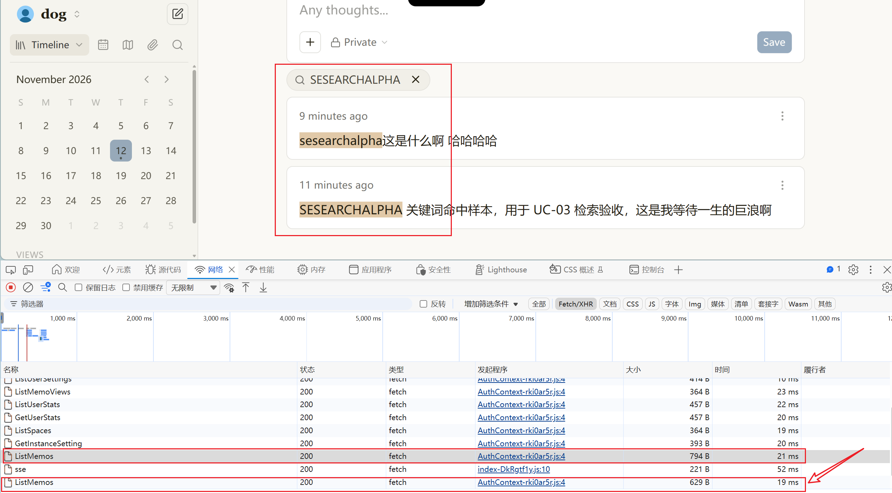 |

### 场景二　无结果与清空恢复

| 项 | 记录 |
| --- | --- |
| 账号角色 | 同上 |
| 测试数据 | `SESEARCHNONE`（确认不在任何样本正文中） |
| 步骤 | 清空 Network → 搜索 `SESEARCHNONE` → 记录结果与 `ListMemos` → 点击清除筛选（或删掉关键词）再看 Network |
| 预期 | 空状态提示；清除后恢复原列表并重新请求 |
| 实际 | 显示 `No matching memos · Clear filters`，`ListMemos` 200、响应 364 B；清除条件下再出现一条 `ListMemos`（794 B），列表恢复 4 条 |
| 截图 | 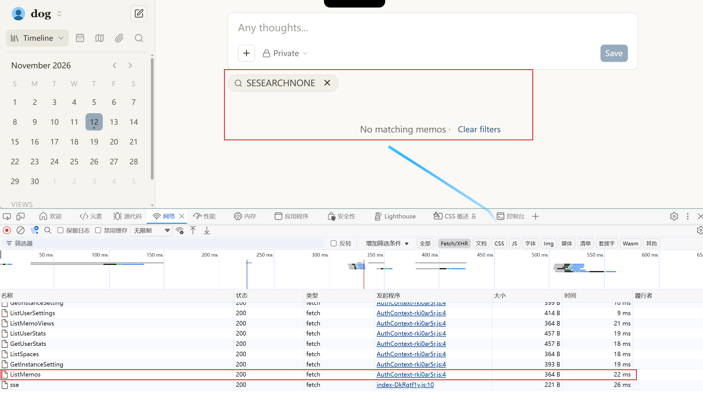　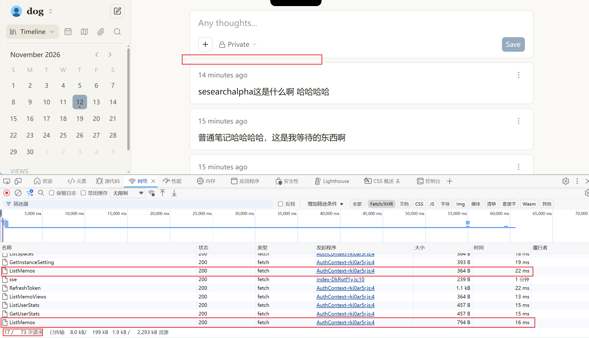 |

### 场景三　大小写边界

| 项 | 记录 |
| --- | --- |
| 账号角色 | 同上 |
| 测试数据 | 全小写 `sesearchalpha` |
| 步骤 | 清空 Network → 输入全小写关键词 → 观察结果条数与高亮 |
| 预期 | 与全大写结果一致（大小写不敏感） |
| 实际 | 2 条，A（全大写）与 D（小写）都命中并高亮。源码依据见第四节 ANN-UC03-01 |
| 截图 | 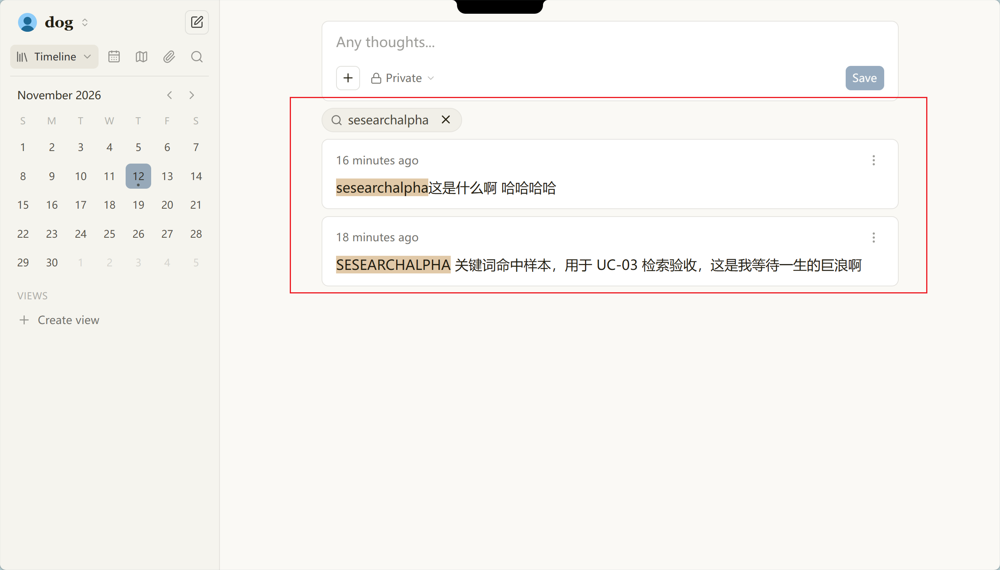 |

### 场景四　元字符边界

| 项 | 记录 |
| --- | --- |
| 账号角色 | 同上 |
| 测试数据 | `SESEARCHALPHA%` |
| 步骤 | 清空 Network → 输入带 `%` 的关键词 → 观察结果 |
| 预期 | `%` 不作通配符，按字面匹配，因此 0 条 |
| 实际 | 0 条，空状态。说明前端把用户输入整体加引号（`escapeFilterValue`），后端渲染时又做了 LIKE 转义 |
| 截图 | 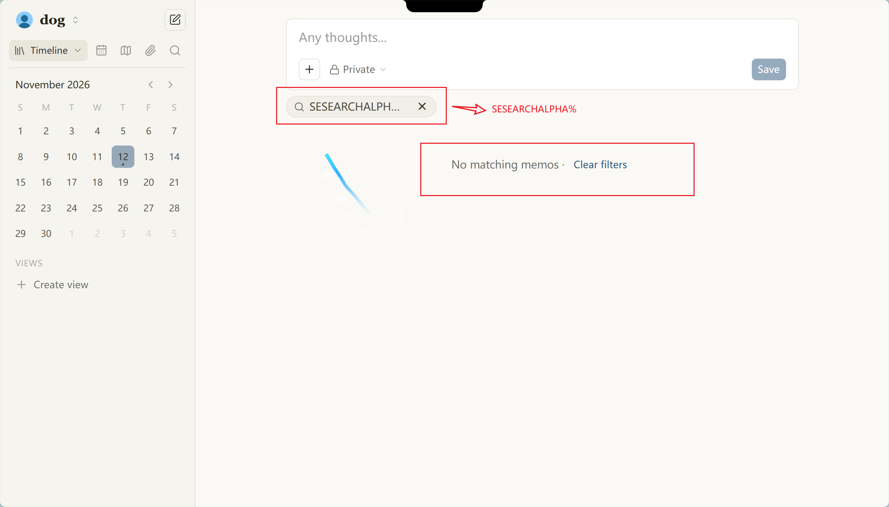 |

### 场景五　日期筛选与跨时区

| 项 | 记录 |
| --- | --- |
| 账号角色 | 同上 |
| 测试数据 | 11-12（有 4 条样本）、11-11（无样本）、11-13（无样本）；同一批样本在两种浏览器时区下的「今天」 |
| 步骤 | ①搜索框切到表达式模式，输入 `created_ts >= timestamp("2026-11-12T00:00:00+08:00") && created_ts < timestamp("2026-11-13T00:00:00+08:00")` ②把日期换成 11-13 再试 ③F12 → 传感器，时区改 `America/Los_Angeles`，刷新后看日历「今天」 |
| 预期 | 11-12 → 4 条；11-13 → 0 条；洛杉矶时区下「今天」变成 11 号 |
| 实际 | 11-12 → 4 条；11-13 → 0 条（`No matching memos`）；洛杉矶时区下左侧日历高亮 11 号，改回上海恢复 12 号 |
| 截图 | 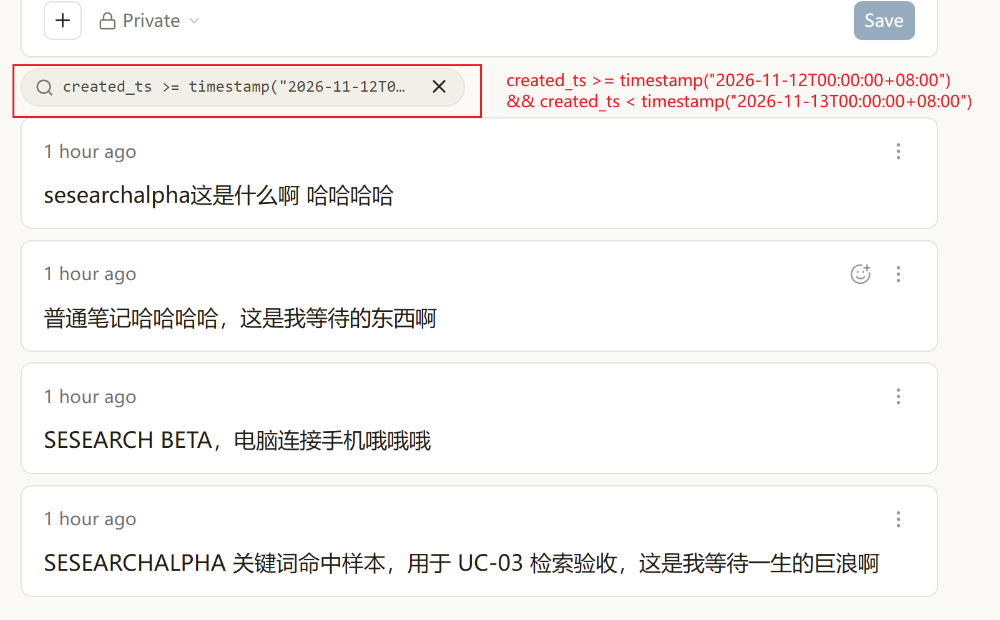　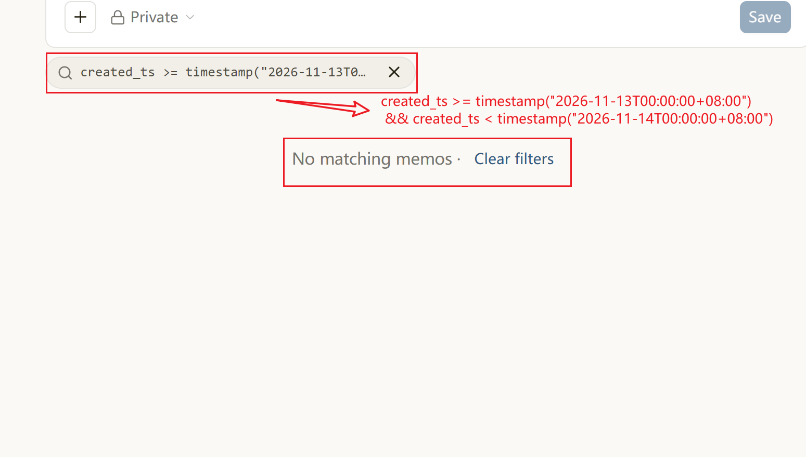　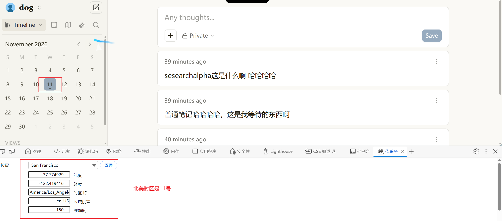　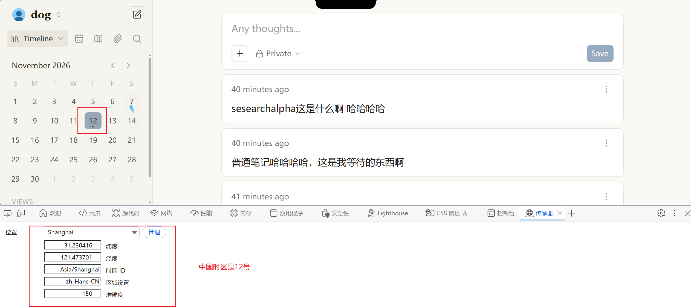 |

> 日期口径：界面选日期时，前端把「本地日历日」换算成 epoch 秒区间（`calendar-utils.ts:44`），后端按 `created_ts` 比较（`getTimeBasisField` 默认 `created_ts`，可在视图里切 `updated_ts`）。接口返回的 `createTime` 是 UTC（如 `06:52:37Z`），界面显示的是本地时间（`14:52:37`），两者相差 8 小时——这是本功能最容易记错的一处。

### 场景六　条件组合

| 项 | 记录 |
| --- | --- |
| 账号角色 | 同上 |
| 测试数据 | 关键词 `SESEARCHALPHA` + 日期区间 11-12 |
| 步骤 | 先加关键词，再加日期表达式，观察结果与最终的 `filter` 文本 |
| 预期 | 两个条件是 AND，交集 2 条 |
| 实际 | 2 条（A、D）。可用 `?filter=` 直接把组合条件写进地址栏复现，便于截图留证 |
| 截图 | 见场景一与场景五，组合后的地址栏条件可用文字完整呈现 |

**REST 交叉验证**（同一数据集、同一条件，排除界面渲染的干扰）：`GET /api/memos?pageSize=100&filter=...` 全部返回 200，条数与界面一致；`SESEARCHNONE` 返回 `{"memos":[],"nextPageToken":""}`。

---

## 三 源码与模块对应

调用方向：**界面入口 → 前端拼装 → 请求 → 服务端 → 过滤器 → 存储**

| 段 | 文件 | 函数 | 行范围 | 输入 → 输出 | 固定链接 |
| --- | --- | --- | --- | --- | --- |
| 界面入口 | `web/src/components/AppSidebar/QuickFindDialog.tsx` | `buildSearchFilters` | 22-35 | 输入文本 + 模式（文字/表达式）→ `MemoFilter[]` | [链接](https://github.com/usememos/memos/blob/b40d8a7b573774c52b022c8d6537d6baf2129dc0/web/src/components/AppSidebar/QuickFindDialog.tsx#L22-L35) |
| 筛选项与 URL | `web/src/contexts/MemoFilterContext.tsx` | `parseFilterQuery` / `stringifyFilters` | 26-50 | `?filter=factor:value` ↔ `MemoFilter[]` | [链接](https://github.com/usememos/memos/blob/b40d8a7b573774c52b022c8d6537d6baf2129dc0/web/src/contexts/MemoFilterContext.tsx#L26-L50) |
| 前端拼装 CEL | `web/src/hooks/useMemoFilters.ts` | `useMemoFilters` | 52-56 | 筛选项 → `content.contains("…")` 或原样表达式 | [链接](https://github.com/usememos/memos/blob/b40d8a7b573774c52b022c8d6537d6baf2129dc0/web/src/hooks/useMemoFilters.ts#L52-L56) |
| 时间区间换算 | `web/src/lib/calendar-utils.ts` | `getLocalDayTimestampRange` / `buildTimestampRangeFilter` | 44-65 | `YYYY-MM-DD` → `[startTs, endTs)` | [链接](https://github.com/usememos/memos/blob/b40d8a7b573774c52b022c8d6537d6baf2129dc0/web/src/lib/calendar-utils.ts#L44-L65) |
| 请求发出 | `web/src/hooks/useMemoQueries.ts` | `useInfiniteMemos` | 250-270 | filter/分页 → `listMemos`（Connect RPC，二进制 protobuf） | [链接](https://github.com/usememos/memos/blob/b40d8a7b573774c52b022c8d6537d6baf2129dc0/web/src/hooks/useMemoQueries.ts#L250-L270) |
| 服务端入口 | `server/api/memo_service.go` | `APIService.ListMemos` | 85-160 | `ListMemosRequest` → 校验 filter、组装 `FindMemo`、取数据并转 pb | [链接](https://github.com/usememos/memos/blob/b40d8a7b573774c52b022c8d6537d6baf2129dc0/server/api/memo_service.go#L85-L160) |
| 条件合法性校验 | `server/api/filter_access.go` | `validateMemoFilterForUser` | 15-40 | filter 文本 → 编译+渲染校验，非法则 `InvalidArgument` | [链接](https://github.com/usememos/memos/blob/b40d8a7b573774c52b022c8d6537d6baf2129dc0/server/api/filter_access.go#L15-L40) |
| 条件拼进 SQL | `filter/helpers.go` | `AppendConditions` | 9-25 | filter 列表 → `where[]` + `args[]`（参数分离） | [链接](https://github.com/usememos/memos/blob/b40d8a7b573774c52b022c8d6537d6baf2129dc0/filter/helpers.go#L9-L25) |
| SQL 查询 | `store/db/sqlite/memo.go` | `(*DB).ListMemos` | 118-190 | `FindMemo` → rows（排序、分页、排除评论） | [链接](https://github.com/usememos/memos/blob/b40d8a7b573774c52b022c8d6537d6baf2129dc0/store/db/sqlite/memo.go#L118-L190) |
| 可见性谓词 | `store/db/sqlite/memo.go` | `sqliteMemoAccessPredicate` 调用处 | 176-178 | `Access` → SQL 谓词，与检索条件 AND | [链接](https://github.com/usememos/memos/blob/b40d8a7b573774c52b022c8d6537d6baf2129dc0/store/db/sqlite/memo.go#L176-L178) |
| 关键词匹配渲染 | `filter/render.go` | `foldedLike` / `likePattern` | 580-600 | 关键词 → `%值%` + 转义 + 方言大小写折叠 | [链接](https://github.com/usememos/memos/blob/b40d8a7b573774c52b022c8d6537d6baf2129dc0/filter/render.go#L580-L600) |
| 日期访问器渲染 | `filter/render.go` | `timestampAccessorExpr` | 282-300 | `created_ts.getDate()` → 方言表达式 | [链接](https://github.com/usememos/memos/blob/b40d8a7b573774c52b022c8d6537d6baf2129dc0/filter/render.go#L282-L300) |

**两条链路图**（按实际操作顺序绘制，用户 → 界面 → 实际请求 → 服务端 → 存储）

- 关键词检索：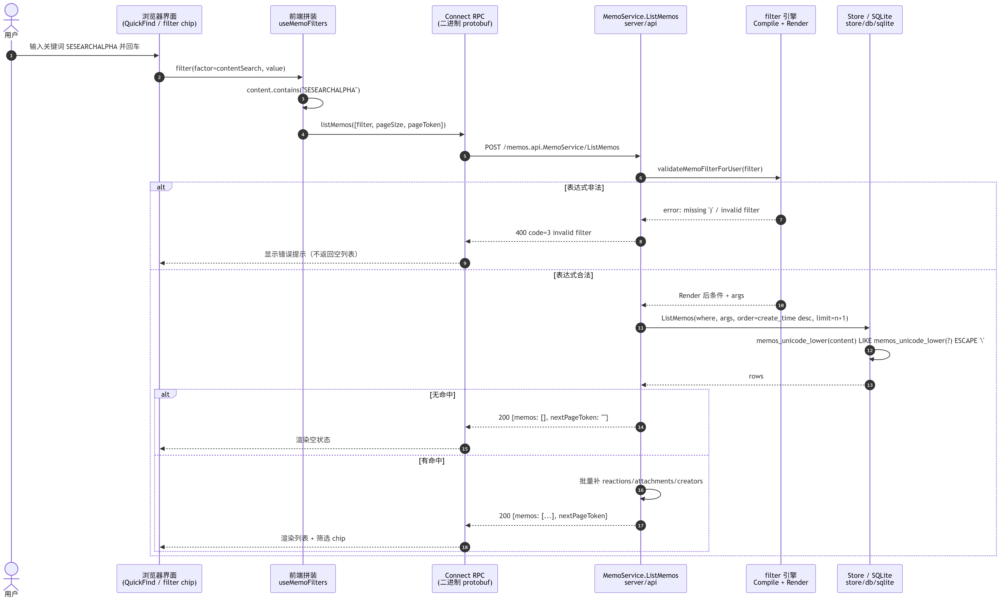
- 日期筛选：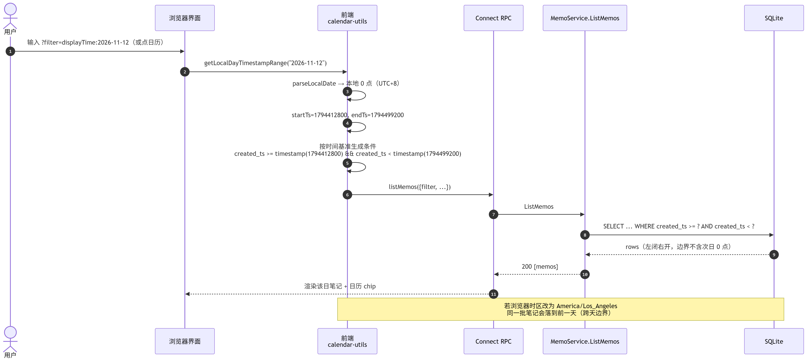

**空结果在哪里产生**：服务端不报错，返回 `200` + 空数组与可能的 `nextPageToken`（`memo_service.go` 中 `len(memos)==0` 分支）；界面据此渲染 `No matching memos`。也就是说「空」是正常返回，不是异常分支。

---

## 四 代码标注

### ANN-UC03-01　要塞：关键词大小写不敏感依赖自定义 SQLite 函数

- 文件 `filter/render.go`　函数 `(*renderer).foldedLike`　提交 `b40d8a7`　原始行范围 578-593
- 佐证：`store/db/sqlite/functions.go:30-40` 注册 `memos_unicode_lower`；SQLite 原生 LIKE 只对 ASCII 折叠，不加这个函数中文与全角字符不会被正确折叠。

```go
// [要塞] 关键词检索的"大小写不敏感"不是 SQLite 自带能力，而是本函数选择了
// 方言专用的比较方式：SQLite 下两侧都过 memos_unicode_lower()，并用 ESCAPE 指定转义符。
// 这段真实代码支撑的业务行为：用户输入 sesearchalpha 也能命中正文里的 SESEARCHALPHA（第二节场景三）。
func (r *renderer) foldedLike(colExpr, pattern string) string {
	switch r.dialect {
	case DialectSQLite:
		// memos_unicode_lower gives Unicode-aware folding; ESCAPE '\' is required
		// because SQLite has no default LIKE escape character.
		return fmt.Sprintf(`memos_unicode_lower(%s) LIKE memos_unicode_lower(%s) ESCAPE '\'`, colExpr, r.addArg(pattern))
	case DialectPostgres:
		// ILIKE is case-insensitive; backslash is the default escape character.
		return fmt.Sprintf("%s ILIKE %s", colExpr, r.addArg(pattern))
	default: // MySQL: default collation is case-insensitive; backslash is the default escape.
		return fmt.Sprintf("%s LIKE %s", colExpr, r.addArg(pattern))
	}
}
```

> 上面片段摘自上游源码，`// [要塞]` 三行为本组添加的中文注释，其余为原始代码。

### ANN-UC03-02　雷区：日期访问器按 UTC 取日，和界面口径不一致

- 文件 `filter/render.go`　函数 `(*renderer).timestampAccessorExpr`　提交 `b40d8a7`　原始行范围 282-300
- 触发条件：手写 `created_ts.getDate()`、`getHours()` 一类表达式，且样本是在东八区凌晨 00:00–07:59 创建的。
- 影响：访问器在 SQLite/Postgres 上都按 UTC 取字段，界面日期筛选却按「浏览器本地日历日」换算区间。同一批笔记，两种写法会落到不同日期桶，而且不会报错，只静默返回错误集合。
- 验证状态：**已实测（部分）**——本次 4 条样本都在 14:5x，未触发跨日；已实测到「时区改成 America/Los_Angeles 后，同一批笔记的日历日为 11 号」（第二节场景五，`uc03-timezone-la.png`）。凌晨样本的跨日是**待核实推测**。

```go
// [雷区] 提取按 UTC 进行：SQLite 用 strftime(..., 'unixepoch') 取时间后再按 offset 调整，
// Postgres 显式 AT TIME ZONE 'UTC'。因此 getDate()/getHours() 得到的是 UTC 分量，
// 与界面上"本地某一天"不是同一个概念。要按本地日历日筛，必须像界面那样用 epoch 区间写法。
func (r *renderer) timestampAccessorExpr(field Field, accessor string) (string, error) {
	spec, ok := accessorSpecs[accessor]
	if !ok {
		return "", errors.Errorf("unsupported timestamp accessor %q", accessor)
	}
	col := qualifyColumn(r.dialect, field.Column)
	var base string
	var off int
	switch r.dialect {
	case DialectSQLite:
		base = fmt.Sprintf("CAST(strftime('%s', %s, 'unixepoch') AS INTEGER)", spec.sqlite, col)
		off = spec.off[0]
	case DialectPostgres:
		base = fmt.Sprintf("CAST(EXTRACT(%s FROM to_timestamp(%s) AT TIME ZONE 'UTC') AS INTEGER)", spec.pg, col)
		off = spec.off[1]
```

> 片段节选了 SQLite / Postgres 两个分支，省略了后续拼接部分；`// [雷区]` 四行为本组注释。

---

## 五 质量观察与维护候选

**观察 1：关键词检索走全表扫描**

| 项 | 内容 |
| --- | --- |
| 现状 | `content.contains` 渲染为 `memos_unicode_lower(content) LIKE memos_unicode_lower(?) ESCAPE '\'`，`content` 列无索引 |
| 证据 | `filter/render.go:580-600` 的渲染逻辑 + `store/migration/sqlite/LATEST.sql:55` 的建表语句（仅 `idx_memo_creator_id`、`idx_memo_space_id`）；实测 64 条数据检索 4–6 ms |
| 影响用户 | 笔记数量上千的长期用户；多人实例下响应时间随库增长线性变差 |
| 目标行为 | 关键词检索走索引（SQLite FTS5 或 ngram），语义保持「包含 + 大小写不敏感 + 元字符转义」 |
| 涉及模块 | `filter/render.go`、`store/db/sqlite/memo.go`、`store/migration/sqlite/` |
| 检查条件 | 同一查询在改动前后返回集合完全一致；1 万条数据下 P95 明显下降 |
| 成本 | 中：需要新增迁移与索引，且要处理中文分词选择 |

**观察 2：日期访问器与界面日期口径不一致**（对应第四节雷区）

| 项 | 内容 |
| --- | --- |
| 现状 | 表达式里的 `getDate()` 等按 UTC 取，界面日期筛选按本地日历日换算区间，两者不一致且都不提示 |
| 证据 | `filter/render.go:282-300` 注释与实现；`web/src/lib/calendar-utils.ts:44-65` 的区间写法 |
| 影响用户 | 手写表达式的高级用户；跨时区或凌晨创建的笔记会「差一天」 |
| 目标行为 | 访问器支持时区参数（或明确文档化按 UTC），界面/文档给出提示 |
| 涉及模块 | `filter/render.go`、前端日期筛选、帮助文档 |
| 检查条件 | 东八区 00:30 创建的笔记，两种写法结果一致或差异被明确说明 |
| 成本 | 低（文档与提示）/ 中（改渲染器） |

> 以上两条只作为**维护候选**，编号等组会评审通过后由组长统一编 MNT 号。

---

## 六 阅读收获和待核实问题

**收获**

1. 一次搜索在代码里被拆成四段职责：前端只负责把意图写成 CEL 文本，服务端只负责校验与转交，过滤器负责编译成方言 SQL 并分离参数，存储层负责可见性与排序。排错时先判断问题在哪一段，比直接读 UI 快得多。
2. 「空结果」是正常返回值，不是异常：`ListMemos` 返回空数组，异常只出现在表达式非法（400）时。这一点决定了界面怎么提示、截图怎么取证。
3. 大小写不敏感不是 SQLite 自带，而是 `memos_unicode_lower` 这个自定义函数带来的——这类「以为框架自带其实自己实现」的点，是读源码最容易漏掉的地方。

**待核实**

| 问题 | 已查到哪 | 还差什么 |
| --- | --- | --- |
| 界面直接改地址栏 `?filter=displayTime:2026-11-12` 是否等价于点日历 | `MemoFilterContext` 的 `parseFilterQuery` 确认会把 URL 还原成筛选条件 | 未在本实例上亲自复做一次并截图 |
| 东八区凌晨样本的跨日表现 | 源码注释明确按 UTC 提取 | 需要一条 00:00–07:59 创建的样本才能实测 |
| 大数据量下的检索耗时 | 64 条数据实测 4–6 ms | 需要构造上万条再加压测，当前未做 |

---

## 七 互审与交付记录

**我复核的对象**：宗锌城 UC-04（`uc-04-attachments`），按第 09 页清单逐项核对后填写。

| 互审人 | 日期 | 问题 | 修正结果 | 文件与图片路径 | 最后更新 |
| --- | --- | --- | --- | --- | --- |
| 宋佳辉 → UC-04 | 待对方页面定稿 | 待填写 | 待填写 | `docs/phase-1/uc-04-attachments.md` | — |
| 吴政泓 → UC-03 | 待定稿 | 待填写 | 待填写 | `docs/phase-1/uc-03-search.md` | 2026-11-14 |

**交付清单**

| 项 | 状态 | 位置 |
| --- | --- | --- |
| Wiki 页 `uc-03-search` | 已建，待按本 Markdown 同步 | 主仓库 Wiki |
| 同名 Markdown | 本文件 | `docs/phase-1/uc-03-search.md` |
| 关键词命中 / 无结果 / 日期筛选图片 | 11 张 | `docs/phase-1/assets/uc03-*.png` |
| 查询链路（界面→请求→服务端→存储） | 第三节表格 + 两张顺序图 | 本文 |
| 两条带片段标注 | ANN-UC03-01（要塞）、ANN-UC03-02（雷区） | 第四节 |
| 质量观察 / 维护候选 | 两条 | 第五节 |
| 交张凯硕的素材 | 用例图、概念类图（可编辑源码见另一文件） | 组内交付 |
