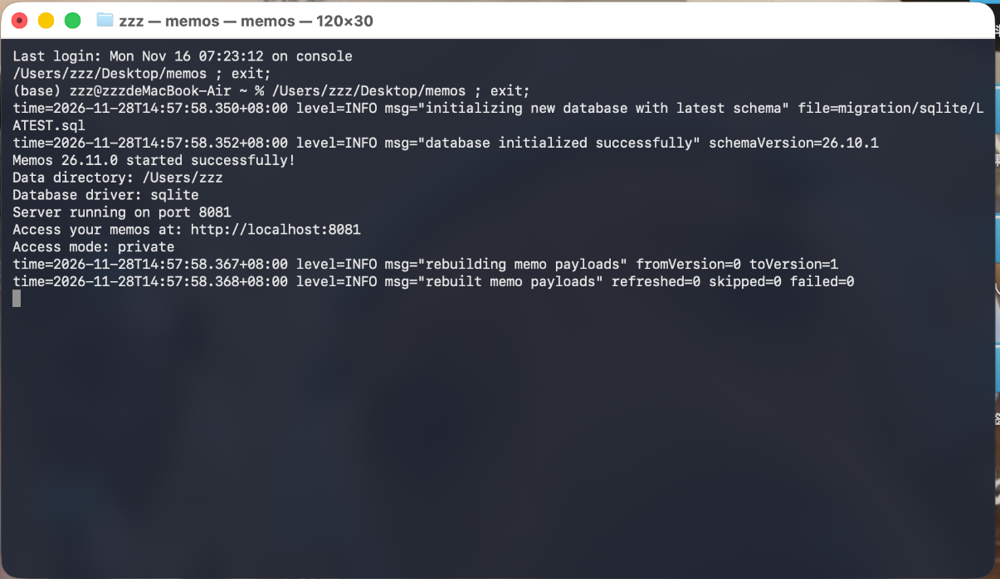
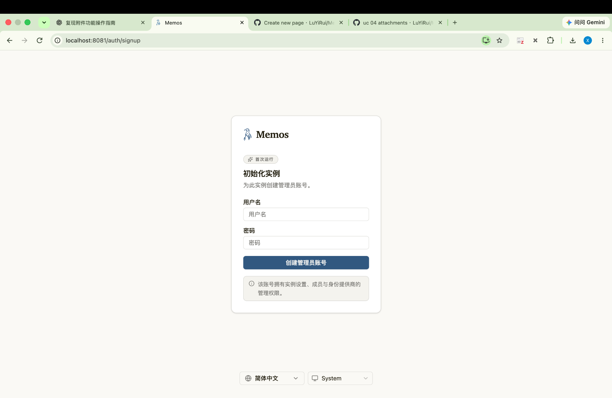
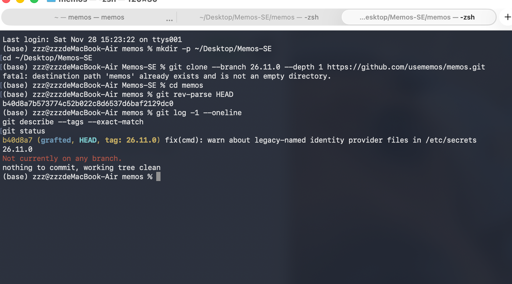
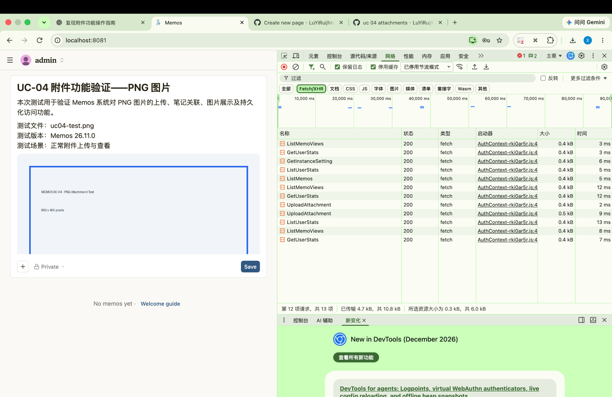
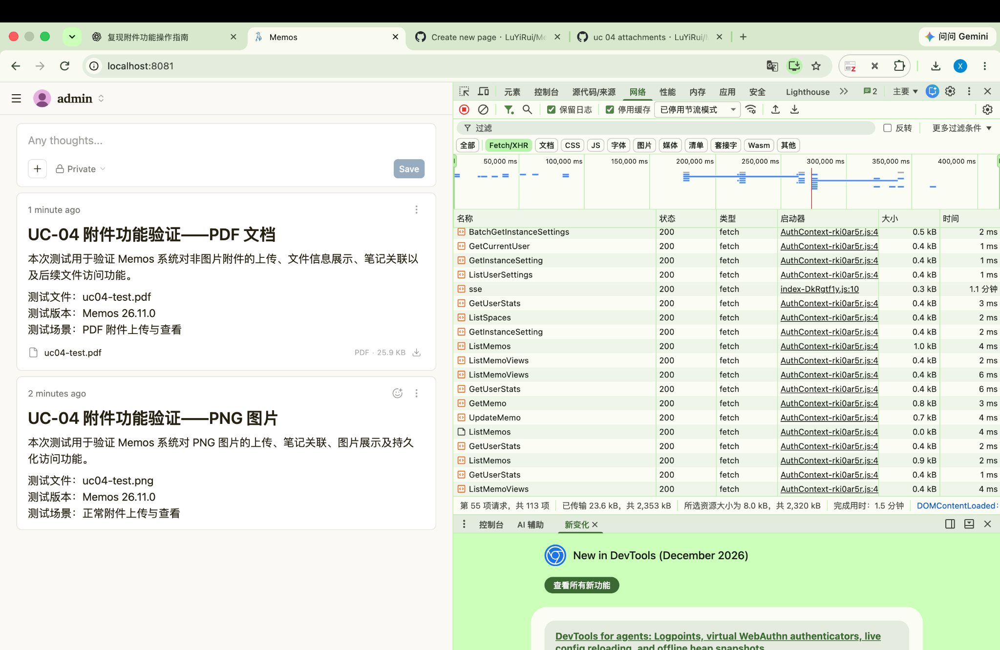
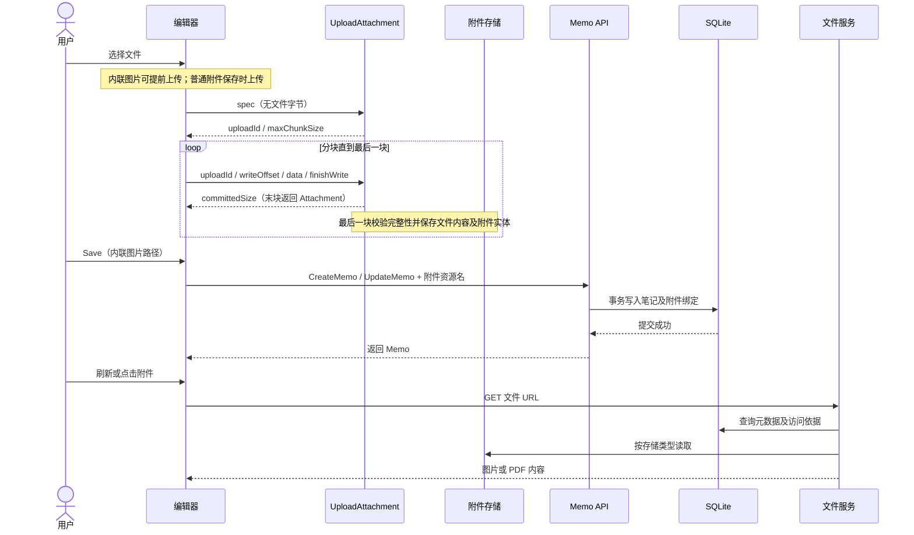

# UC-04 附件上传与查看

| 项目 | 内容 |
| --- | --- |
| 负责人 | 宗锌城 |
| 互审人 | 谢宇轩 |
| 阅读与运行基线 | 26.11.0 |
| 完整源码提交号 | `b40d8a7b573774c52b022c8d6537d6baf2129dc0` |
| 本人运行环境 | macOS；官方原生可执行程序（非 Docker）；SQLite；Chrome；本地 `http://localhost:8081`；private 模式 |
| 当前状态 | 已完成主要正常场景、移除操作和固定版本源码分析；待补充刷新、PDF 实际打开或下载、存储配置截图及互审 |
| 组内截止时间 | 待组长填写 |
| 最后更新日期 | 2026-11-28 |

## 一、本页任务清单

- [x] 准备 PNG 与 PDF 测试材料。
- [ ] 分别记录上传成功和笔记关联成功：PNG 上传、PDF 关联已有截图；待补 PNG 保存结果及 PDF 上传独立请求证据。
- [ ] 保存后刷新并核实图片显示及 PDF 打开或下载。
- [ ] 核对当前实例存储配置并与张凯硕确认。
- [x] 完成移除附件操作并记录请求与界面结果（刷新后的复核待补）。
- [x] 完成功能需求还原和已有证据整理。
- [x] 串联界面、请求、服务端和存储层。
- [x] 完成要塞与雷区源码标注。
- [x] 整理质量观察、维护候选及阅读收获。
- [ ] 完成组内互审、修正、归档并报告。

## 二、功能与需求还原

| 项目 | 当前版本的实际行为 |
| --- | --- |
| 目标用户与角色 | 已登录且有相应写入权限的笔记创建者、编辑者，以及具有笔记或附件读取权限的用户。本次运行角色为实例管理员 admin。 |
| 业务目的 | 在文本笔记中保存图片、PDF 等文件，并在后续查询时获取相应附件。 |
| 操作入口 | 编辑器底部加号菜单；图片可走内联插入路径，普通附件可进入本地待上传列表；保存后在正文或附件区展示。 |
| 前置条件 | 实例正常运行，用户通过认证并有相应权限，存储后端可用，文件满足配额与格式约束。 |
| 输入 | 浏览器 File 对象、文件名、MIME 类型、总字节数；上传会话 ID、写入偏移量、分块数据、结束标志；保存笔记时的正文、可见性、附件资源名等。 |
| 主要操作流程 | 选择文件；生成上传规格并申请会话；分块发送；服务端检查并持久化附件；创建或更新笔记以绑定附件；查询笔记并通过文件服务读取。普通附件可在保存时上传，内联图片可在保存前上传。 |
| 输出与成功后的状态 | 上传阶段返回附件资源及已提交字节数；笔记保存阶段返回包含关联附件的 Memo；图片可展示，PDF 提供打开及下载入口。 |
| 权限、异常和使用边界 | 校验用户、文件名、MIME 格式、配额、分块大小和偏移量；上传结束再检查配额；更新笔记时核对管理权限、附件归属及正文中的受管理附件引用。移除已关联附件会删除附件记录，而非仅置空 memo_id。 |
| 与其他功能或模块的关系 | React 编辑器、Connect RPC、笔记 API、附件 API、Store 与 SQLite 驱动、文件服务及实例存储设置；与部署/存储模块协同。 |

## 三、实际操作与证据

测试日期：2026-11-28；账号角色：本地实例管理员；版本及环境见页首。测试文件为 `uc04-test.png`（800×450）和 `uc04-test.pdf`（界面显示 25.9 KB）。证据以实际截图为准；源码结论不代替本地未完成测试。

| 场景 | 操作提示 | 预期结果及依据 | 实际结果 | 证据 |
| --- | --- | --- | --- | --- |
| PNG 上传 | 在编辑器选择 PNG，观察 Network，保存笔记 | 分块上传成功并返回附件；保存后关联（uploadService、memoService） | 编辑器显示图片，存在两条 UploadAttachment 请求，均为 HTTP 200，Save 仍可点击；PNG 保存后的完整图片展示截图待补 | 图3 |
| PDF 上传 | 选择 PDF 并保存笔记 | 文件名与附件类型正确显示，建立笔记关联 | 已保存笔记显示 uc04-test.pdf、PDF、25.9 KB 及下载图标；单独上传请求截图待补 | 图4 |
| 刷新与查看 | 保存后刷新，查看 PNG；点击 PDF 名称或下载图标 | 重新查询仍有对应附件，PDF 可通过文件路由访问 | 待补刷新后 PNG 展示及 PDF 实际访问截图；不能仅凭下载图标判断文件下载成功 | 待补 |
| 边界验证 | 编辑 PNG 笔记，移除图片并保存 | 保留笔记正文；附件记录被删除；其他笔记不受影响 | PNG 正文保留，图片不再显示，PDF 附件仍显示；UpdateMemo、ListMemos 均显示 HTTP 200；数据库行及磁盘文件未单独检查 | 图4 |

### 3.1 环境与版本



*图1 Memos 26.11.0 启动日志（终端区域裁剪）*

启动日志显示 SQLite 初始化成功、8081 端口、数据目录为当前用户主目录、private 模式。截图仅截取终端区域以减少无关桌面信息。



*图2 本地实例初始化界面*



*图5 固定版本源码核验*

源码的 `git rev-parse HEAD` 与团队要求相同，标签为 26.11.0，工作区未修改。重复 clone 的提示由目录已经存在引起，不影响固定版本阅读。

### 3.2 PNG 正常场景



*图3 PNG 上传及 UploadAttachment 请求*

在未保存笔记的截图中已经出现两条成功的 UploadAttachment 请求。结合前端源码，符合先发送规格、再发送小文件数据并完成上传的机制；具体请求载荷未展开，因此不将两条请求的实际字段视为已实测。

### 3.3 PDF 关联与 PNG 移除边界



*图4 PDF 附件展示、PNG 移除结果与 UpdateMemo 请求*

图4 同时证明 PDF 附件随笔记展示、PNG 图片在更新后不再显示以及笔记更新接口成功。PNG 测试正文中的文件名文字仍在，它不是文件附件。

### 3.4 待补证据

- `uc04-06-png-refresh.png`：重新创建 PNG 测试笔记、保存并刷新，保留图片正常展示截图。
- `uc04-07-pdf-view.png`：实际打开 PDF 或下载后打开文件的截图。
- `uc04-08-storage-setting.png`：实例设置中的实际默认附件存储类型与路径（如显示）。
- `uc04-09-png-saved.png`：保存后且尚未移除的 PNG 笔记截图（也可与刷新证据共用）。
- `uc04-10-pdf-upload-request.png`：PDF 上传请求及响应（如需补齐独立证据）。

## 四、功能与代码的对应关系

以下路径、函数与行号均来自本地导出的固定版本源码；链接固定到完整提交号，而非 main。生成文件中的接口定义只用于核对 RPC 名称，重点分析业务实现。

| 环节 | 实际文件 | 函数或组件 | 输入与输出 | 与下一环节的关系 | 固定源码链接 |
| --- | --- | --- | --- | --- | --- |
| 界面入口 | `web/src/components/MemoEditor/edit/Toolbar/InsertMenu.tsx` | InsertMenu 文件选择回调 | LocalFile → 编辑器本地文件状态 | 普通附件等待保存 | [L34–L37](https://github.com/usememos/memos/blob/b40d8a7b573774c52b022c8d6537d6baf2129dc0/web/src/components/MemoEditor/edit/Toolbar/InsertMenu.tsx#L34-L37) |
| 本地文件处理 | `web/src/components/MemoEditor/edit/hooks/useFileUpload.ts` | toLocalFiles / handleFileInputChange | File → 含预览 URL 的 LocalFile | 本地预览并传入回调 | [L15–L45](https://github.com/usememos/memos/blob/b40d8a7b573774c52b022c8d6537d6baf2129dc0/web/src/components/MemoEditor/edit/hooks/useFileUpload.ts#L15-L45) |
| 内联图片 | `web/src/components/MemoEditor/edit/hooks/useInlineImageUpload.ts` | runJob | 图片任务 → 附件与受管理 Markdown | 可在保存前上传 | [L163–L198](https://github.com/usememos/memos/blob/b40d8a7b573774c52b022c8d6537d6baf2129dc0/web/src/components/MemoEditor/edit/hooks/useInlineImageUpload.ts#L163-L198) |
| 请求构造 | `web/src/components/MemoEditor/edit/services/uploadService.ts` | uploadService.uploadFile | 文件 → spec、uploadId、分块请求 → Attachment | 调用 UploadAttachment RPC | [L13–L60](https://github.com/usememos/memos/blob/b40d8a7b573774c52b022c8d6537d6baf2129dc0/web/src/components/MemoEditor/edit/services/uploadService.ts#L13-L60) |
| RPC 接入 | `server/api/connect_services.go` | ConnectServiceHandler.UploadAttachment | Connect 请求 → APIService | 转交业务层 | [L667–L673](https://github.com/usememos/memos/blob/b40d8a7b573774c52b022c8d6537d6baf2129dc0/server/api/connect_services.go#L667-L673) |
| 服务端上传 | `server/api/attachment_upload.go` | UploadAttachment / finishAttachmentUpload | 会话规格或分块 → 上传结果 | 校验并调用持久化处理 | [L40–L103](https://github.com/usememos/memos/blob/b40d8a7b573774c52b022c8d6537d6baf2129dc0/server/api/attachment_upload.go#L40-L103)；[L143–L185](https://github.com/usememos/memos/blob/b40d8a7b573774c52b022c8d6537d6baf2129dc0/server/api/attachment_upload.go#L143-L185) |
| 附件保存 | `server/api/attachment_service.go` | processAndSaveAttachment / persistAttachment | 文件流及实体 → Attachment | 先存内容、再写数据库记录 | [L239–L271](https://github.com/usememos/memos/blob/b40d8a7b573774c52b022c8d6537d6baf2129dc0/server/api/attachment_service.go#L239-L271) |
| 存储分支 | `server/api/attachment_service_storage.go` | saveAttachmentContent | 默认存储配置和文件流 → 本地路径/S3 对象/Blob | 按配置持久化内容 | [L69–L179](https://github.com/usememos/memos/blob/b40d8a7b573774c52b022c8d6537d6baf2129dc0/server/api/attachment_service_storage.go#L69-L179) |
| 笔记请求 | `web/src/components/MemoEditor/edit/services/memoService.ts` | buildUpdateMask / save | 正文、附件资源名 → CreateMemo 或 UpdateMemo | 创建/更新笔记绑定附件 | [L17–L19](https://github.com/usememos/memos/blob/b40d8a7b573774c52b022c8d6537d6baf2129dc0/web/src/components/MemoEditor/edit/services/memoService.ts#L17-L19)；[L48–L51](https://github.com/usememos/memos/blob/b40d8a7b573774c52b022c8d6537d6baf2129dc0/web/src/components/MemoEditor/edit/services/memoService.ts#L48-L51)；[L108–L138](https://github.com/usememos/memos/blob/b40d8a7b573774c52b022c8d6537d6baf2129dc0/web/src/components/MemoEditor/edit/services/memoService.ts#L108-L138) |
| 服务端关联 | `server/api/memo_service.go` | CreateMemo / UpdateMemo | Memo 与附件名 → 新/更新 Memo | 准备附件并执行事务 | [L45–L72](https://github.com/usememos/memos/blob/b40d8a7b573774c52b022c8d6537d6baf2129dc0/server/api/memo_service.go#L45-L72)；[L425–L480](https://github.com/usememos/memos/blob/b40d8a7b573774c52b022c8d6537d6baf2129dc0/server/api/memo_service.go#L425-L480) |
| 关联事务 | `server/api/memo_attachment_service.go` | createMemoWithMutation / applyMemoMutation | 绑定/移除集合 → Store.ApplyMemoMutation | 同步数据库状态并清理外部存储 | [L153–L189](https://github.com/usememos/memos/blob/b40d8a7b573774c52b022c8d6537d6baf2129dc0/server/api/memo_attachment_service.go#L153-L189)；[L235–L256](https://github.com/usememos/memos/blob/b40d8a7b573774c52b022c8d6537d6baf2129dc0/server/api/memo_attachment_service.go#L235-L256) |
| SQLite 驱动 | `store/db/sqlite/memo_attachment.go` | ApplyMemoMutation | 变更集合 → 更新 memo_id 或删除记录 | 事务提交后返回 | [L15–L30](https://github.com/usememos/memos/blob/b40d8a7b573774c52b022c8d6537d6baf2129dc0/store/db/sqlite/memo_attachment.go#L15-L30)；[L82–L154](https://github.com/usememos/memos/blob/b40d8a7b573774c52b022c8d6537d6baf2129dc0/store/db/sqlite/memo_attachment.go#L82-L154) |
| 查询结果 | `server/api/memo_service_converter.go` | convertMemoFromStoreWithCreators | 附件实体列表 → Memo.Attachments | 前端获取附件元数据 | [L90–L94](https://github.com/usememos/memos/blob/b40d8a7b573774c52b022c8d6537d6baf2129dc0/server/api/memo_service_converter.go#L90-L94) |
| 文件访问 | `web/src/utils/attachment.ts` | getAttachmentUrl | 附件资源名/文件名 → URL | 浏览器访问文件路由 | [L3–L9](https://github.com/usememos/memos/blob/b40d8a7b573774c52b022c8d6537d6baf2129dc0/web/src/utils/attachment.ts#L3-L9) |
| PDF 展示 | `web/src/components/MemoMetadata/Attachment/AttachmentListView.tsx` | DocumentRow | PDF 元数据 → 打开链接与下载入口 | 浏览器请求文件内容 | [L196–L259](https://github.com/usememos/memos/blob/b40d8a7b573774c52b022c8d6537d6baf2129dc0/web/src/components/MemoMetadata/Attachment/AttachmentListView.tsx#L196-L259) |
| 文件返回 | `server/fileserver/fileserver.go` | serveAttachmentFile / serveStaticFile | UID、访问权限 → 文件字节或错误 | 按存储类型读取并返回 | [L138–L199](https://github.com/usememos/memos/blob/b40d8a7b573774c52b022c8d6537d6baf2129dc0/server/fileserver/fileserver.go#L138-L199)；[L276–L306](https://github.com/usememos/memos/blob/b40d8a7b573774c52b022c8d6537d6baf2129dc0/server/fileserver/fileserver.go#L276-L306) |

### 4.1 调用过程说明

附件上传和笔记保存是两个相互关联但不等价的阶段。内联图片上传任务在获得 Attachment 后，将资源加入编辑器状态，并在正文中插入受管理的 Markdown 引用。普通文件选择回调先加入 localFiles，在 memoService.save 中统一上传。uploadFile 首次发送文件名、MIME 类型、总大小等规格，后续利用 uploadId 和 writeOffset 发送分块，finishWrite 标识末块；只有最后响应携带 Attachment 才完成该文件上传。后端 UploadAttachment 会检查用户、分块上限与上传会话，finishAttachmentUpload 再检查配额及当前存储配置，执行 processAndSaveAttachment 和 persistAttachment。

保存时，前端将附件对象转换成资源名引用。创建笔记与附件绑定由 createMemoWithMutation 在同一数据库事务中完成。更新时 buildUpdateMask 在附件集合改变时加入 attachments 字段，调用 UpdateMemo；后端 prepareMemoAttachments 求差集并检查权限，同时验证正文引用，避免删除仍被正文引用的受管理附件。SQLite 驱动绑定附件时更新 memo_id，移除时删除匹配笔记的附件行。事务提交后，API 再清理对应的本地/S3 文件。

查看时，查询返回包含 Attachment 的 Memo，前端使用文件 URL 获取内容。服务端先获取元数据、验证读取权限，再读取 Blob 或访问本地/S3 对象；图片及 PDF 允许浏览器内联显示，其他非媒体静态文件强制下载。GetAttachment 是元数据接口，不等同于文件内容路由。SetMemoAttachments 是独立的全量替换接口，使用同一关联准备与事务逻辑，但本次截图实际看到的是 UpdateMemo，不能将 SetMemoAttachments 写成已观察到的请求。



### 4.2 源码链接记录与存储模块核对

- API 契约：[UploadAttachment 定义](https://github.com/usememos/memos/blob/b40d8a7b573774c52b022c8d6537d6baf2129dc0/proto/api/attachment_service.proto#L63-L70)、[分块请求和响应](https://github.com/usememos/memos/blob/b40d8a7b573774c52b022c8d6537d6baf2129dc0/proto/api/attachment_service.proto#L207-L259)。
- 独立关联接口：[SetMemoAttachments](https://github.com/usememos/memos/blob/b40d8a7b573774c52b022c8d6537d6baf2129dc0/server/api/memo_attachment_service.go#L21-L62)；正文引用校验：[resolveMemoAttachmentReferences（起始段）](https://github.com/usememos/memos/blob/b40d8a7b573774c52b022c8d6537d6baf2129dc0/server/api/memo_attachment_service.go#L360-L390)。
- 附件存储配置：[GetInstanceStorageSetting 及默认值](https://github.com/usememos/memos/blob/b40d8a7b573774c52b022c8d6537d6baf2129dc0/store/instance_setting.go#L322-L345)、[默认存储归一化](https://github.com/usememos/memos/blob/b40d8a7b573774c52b022c8d6537d6baf2129dc0/store/storage.go#L59-L85)。源码默认 LOCAL，路径模板 `assets/{timestamp}_{uuid}_{filename}`，也支持 DATABASE 和 S3。本人实例未提供设置截图，因此实际生效配置仍待确认，不能仅因数据库为 SQLite 就认定附件存储为数据库。
- 附件删除权限：[MemoAttachmentRemovalAllowed](https://github.com/usememos/memos/blob/b40d8a7b573774c52b022c8d6537d6baf2129dc0/store/memo_attachment.go#L56-L64)；外部文件清理：[cleanupDeletedAttachmentStorage](https://github.com/usememos/memos/blob/b40d8a7b573774c52b022c8d6537d6baf2129dc0/server/api/attachment_service_storage.go#L227-L250) 与 [DeleteAttachmentStorageWithInstanceSetting / 本地删除](https://github.com/usememos/memos/blob/b40d8a7b573774c52b022c8d6537d6baf2129dc0/store/attachment.go#L261-L288)。
- 与张凯硕核对：待确认实际默认存储、数据目录、附件路径及模块名称；待记录日期。

## 五、代码标注

### ANN-UC04-01 要塞

| 项目 | 内容 |
| --- | --- |
| 原文件与函数 | `server/api/attachment_upload.go`；`(*APIService).UploadAttachment` |
| 完整提交号与原始行范围 | `b40d8a7b573774c52b022c8d6537d6baf2129dc0`；L69–L103 |
| 固定源码链接 | [UploadAttachment 写入与完成逻辑](https://github.com/usememos/memos/blob/b40d8a7b573774c52b022c8d6537d6baf2129dc0/server/api/attachment_upload.go#L69-L103) |
| 关键实现解决的问题 | 在同一上传会话中维护写入进度、检查完整性、支持完成后的安全重试，并返回附件资源。 |
| 与本功能的关系 | 对应截图中实际出现的 UploadAttachment 请求；使 PNG/PDF 文件上传独立于笔记创建或更新。 |

原始代码摘录（新增中文注释，未改动原有逻辑）：

```go
	// 会话已加锁；离开函数时释放锁，避免并发写入破坏状态。
	defer upload.mu.Unlock()
	if err := ctx.Err(); err != nil {
		return nil, status.FromContextError(err).Err()
	}
	// 根据偏移量及末块标识写入文件数据，错误立即返回。
	if err := upload.write(request.WriteOffset, request.Data, request.FinishWrite); err != nil {
		return nil, err
	}
	var attachment *apipb.Attachment
	// 已完成会话重新查询附件并检查访问权限，不重复创建实体。
	if upload.complete {
		// Recheck access and existence; a completed upload must not resurrect a
		// deleted attachment or disclose metadata after access is revoked.
		attachment, err = s.GetAttachment(ctx, &apipb.GetAttachmentRequest{Name: "attachments/" + upload.state.uid})
	} else if request.FinishWrite {
		// 结束写入前核对已提交字节数和声明总大小。
		if upload.committedSize != upload.totalSize {
			return nil, status.Errorf(codes.FailedPrecondition, "upload is incomplete")
		}
		// 完整文件进入存储与持久化流程。
		attachment, err = s.finishAttachmentUpload(ctx, upload)
		if err == nil {
			upload.complete = true
			os.Remove(upload.path)
		// 配额拒绝时移除临时文件并使会话过期。
		} else if isQuotaExceeded(err) {
			// A refused upload cannot succeed by retrying the finish: drop its
			// bytes and revoke it, so nothing of it stays stored.
			os.Remove(upload.path)
			upload.expireTime = time.Time{}
		}
	}
	if err != nil {
		return nil, err
	}
	// 延长会话有效期，返回进度、资源及分块大小上限。
	upload.expireTime = time.Now().Add(uploadTTL)
	return &apipb.UploadAttachmentResponse{
		UploadId: id, CommittedSize: upload.committedSize, Attachment: attachment, MaxChunkSize: uploadChunkSize,
	}, nil
}
```

补充：[uploadSession.write](https://github.com/usememos/memos/blob/b40d8a7b573774c52b022c8d6537d6baf2129dc0/server/api/upload_session.go#L47-L84) 使用偏移量与 SHA-256 摘要处理重复块，拒绝超出总大小或错误偏移的写入。前端 [uploadFile 分块与校验](https://github.com/usememos/memos/blob/b40d8a7b573774c52b022c8d6537d6baf2129dc0/web/src/components/MemoEditor/edit/services/uploadService.ts#L25-L57) 对相同请求的 Unavailable 错误最多额外重试两次，并核对 committedSize。已有测试 [TestUploadAttachmentChunksAndRetries](https://github.com/usememos/memos/blob/b40d8a7b573774c52b022c8d6537d6baf2129dc0/server/api/attachment_upload_test.go#L54-L97) 覆盖分块及重试。这里只阅读了测试代码，未执行 Go 测试。

### ANN-UC04-02 雷区

| 项目 | 内容 |
| --- | --- |
| 原文件与函数 | `server/api/memo_attachment_service.go`；`(*APIService).applyMemoMutation` |
| 完整提交号与原始行范围 | `b40d8a7b573774c52b022c8d6537d6baf2129dc0`；L235–L256 |
| 固定源码链接 | [事务完成后的附件存储清理](https://github.com/usememos/memos/blob/b40d8a7b573774c52b022c8d6537d6baf2129dc0/server/api/memo_attachment_service.go#L235-L256) |
| 边界或风险点 | 数据库事务与外部文件清理不属于同一原子事务。 |
| 触发条件与影响 | 更新笔记并移除附件，数据库已提交，而本地文件/S3 清理失败；笔记与附件行已改变，但接口返回 Internal 错误，文件可能残留。 |
| 已有保护或约束 | 前置权限与引用校验、SQLite 事务回滚与行数检查；清理错误被显式返回，避免静默报告完全成功。 |
| 验证状态 | 源码及仓库已有故障注入测试的断言确认；本人正常移除操作成功，未在本地人为注入失败。属于有测试依据的设计边界，不宣称本地复现缺陷。 |

```go
	// 将笔记更新、附件绑定与移除信息交给存储层统一处理。
	mutation := &store.MemoMutation{
		MemoID:                    memo.ID,
		MemoCreatorID:             memo.CreatorID,
		ExpectedMemoContent:       memo.Content,
		MemoUpdate:                memoUpdate,
		Bindings:                  bindings,
		// 需删除的附件 ID；驱动在事务中重新检查归属与状态。
		RemovedAttachmentIDs:      removedAttachmentIDs,
		RequiredAttachmentIDs:     requiredAttachmentIDs,
		ReplaceReferenceRelations: referenceRelations != nil,
		Policy:                    policy,
	}
	if referenceRelations != nil {
		mutation.ReferenceRelations = *referenceRelations
	}
	// 先执行数据库事务，失败则不进入后续文件清理。
	if err := s.Store.ApplyMemoMutation(ctx, mutation); err != nil {
		return mapMemoWriteError(err, "failed to apply memo mutation")
	}
	// 数据库事务已成功返回；外部文件删除不在该事务内。
	if err := s.cleanupDeletedAttachmentStorage(ctx, prepared.removed); err != nil {
		// 清理失败时明确说明笔记其实已经更新，而非整次操作回滚。
		return status.Errorf(codes.Internal, "memo was updated but attachment storage cleanup failed: %v", err)
	}
	return nil
}
```

SQLite 关联删除的关键实现如下（[ApplyMemoMutation L115–L125](https://github.com/usememos/memos/blob/b40d8a7b573774c52b022c8d6537d6baf2129dc0/store/db/sqlite/memo_attachment.go#L115-L125)）：

```go
	// 移除集合中的附件记录，并限制为当前笔记，避免误删其他笔记的附件。
	for _, attachment := range removedAttachments {
		result, err := conn.ExecContext(ctx, `DELETE FROM attachment WHERE id = ? AND memo_id = ?`, attachment.ID, mutation.MemoID)
		if err != nil {
			return errors.Wrap(err, "failed to delete removed attachment")
		}
		// 确认恰好删除一行；不符合时作为并发状态冲突返回。
		if rows, err := result.RowsAffected(); err != nil {
			return errors.Wrap(err, "failed to count deleted removed attachment")
		} else if rows != 1 {
			return errors.Wrap(store.ErrMemoMutationConflict, "attachment is no longer bound to the memo")
		}
	}
```

仓库已有测试 `local deletion failure reports committed row deletion`（[故障注入及断言](https://github.com/usememos/memos/blob/b40d8a7b573774c52b022c8d6537d6baf2129dc0/server/api/test/memo_attachment_markdown_test.go#L239-L278)）明确断言：模拟存储删除失败时，UpdateMemo 返回 Internal，笔记正文已更新，附件数据库记录不存在，但本地文件仍存在。正常移除测试同样断言附件记录为 nil（[正常移除断言](https://github.com/usememos/memos/blob/b40d8a7b573774c52b022c8d6537d6baf2129dc0/server/api/test/memo_attachment_markdown_test.go#L230-L237)）。因此不能将本版本的移除操作简单表述为解除关联；也不能根据图4 推断磁盘文件必然已删除。

## 六、质量观察与维护候选

| 项目 | 内容 |
| --- | --- |
| 候选名称 | 附件移除后外部存储清理失败的恢复与状态反馈优化 |
| 当前行为与证据 | 正常移除已在本地观察到 UpdateMemo HTTP 200、图片消失；异常路径由 applyMemoMutation L249–254 及已有故障注入测试证明，数据库已提交但清理失败时返回 Internal。 |
| 观察类型 | 可靠性、可维护性、易用性；属于有源码依据的维护候选。 |
| 影响用户与发生条件 | 使用本地文件或 S3 的实例中，删除文件时遇到权限异常、存储暂时不可用等；操作者可能误认为笔记未保存，管理员需处理残留对象。 |
| 期望维护后的具体行为 | 明确区分笔记变更已提交与文件清理待处理；对可恢复的清理失败建立受控重试记录，成功后关闭待处理任务，向授权管理员提供可诊断状态。 |
| 输入、操作、输出和异常边界 | 输入为合法笔记修改及移除附件请求；正常返回更新结果；异常时标记清理待处理并保留必要的内部定位信息；重复执行须幂等且不可误删其他用户文件。 |
| 预计涉及模块 | server/api/memo_attachment_service.go；server/api/attachment_service_storage.go；store/attachment.go；必要时扩展持久化清理任务与前端 useMemoSave 的错误反馈。 |
| 完成后的检查条件 | 正常移除不回归；模拟删除失败时数据库状态明确；恢复存储后安全重试；重复重试不误删；无权限用户无法触发或获取内部路径；SQLite、LOCAL、S3 路径分别验证。 |
| 实现成本、兼容性或数据影响 | 中等。若新增可靠清理队列需持久化任务、重试策略、引用/对象身份校验及迁移；优先保持现有 RPC 契约，若扩展错误细节需评估旧客户端兼容性。数据库 Blob 删除不需要外部文件重试。 |
| 当前状态 | 待组内评审；未实现，不分配 MNT 编号。 |

当前实现已具有权限校验、事务和错误返回机制，维护重点是提交后的恢复与用户可辨识反馈，而不是重复实现已有的删除权限保护。验证应使用隔离测试实例及仓库既有 failpoint，不在团队共享实例中故意制造存储故障。

## 七、阅读收获与待核实问题

| 类型 | 具体内容 | 依据或已查到的位置 | 下一步 |
| --- | --- | --- | --- |
| 阅读收获 | 附件上传与保存笔记分阶段，内联图片与普通文件入口不同 | uploadService、useInlineImageUpload、memoService | 用实际请求对应调用链 |
| 阅读收获 | 关联更新由服务端计算差集，移除已绑定附件会删除数据库记录 | prepareMemoAttachments、SQLite ApplyMemoMutation | 区分界面证据与数据库证据 |
| 阅读收获 | 数据库事务与文件系统/S3 操作具有不同一致性边界 | applyMemoMutation、故障注入测试 | 评估清理重试候选 |
| 阅读收获 | 文件元数据接口与内容路由不同，先鉴权再读取内容 | serveAttachmentFile | 与存储模块核对 |
| 待核实问题 | 当前实例默认附件存储类型、路径及适用配额 | GetInstanceStorageSetting、StorageSection | 截图设置页面并与张凯硕确认 |
| 待核实问题 | PNG 保存后刷新、PDF 实际打开/下载、PDF 独立上传请求 | 实际操作证据尚不完整 | 补图6–10中适用证据 |
| 待核实问题 | 本人移除的 PNG 对应磁盘文件是否删除 | 源码已确认删除机制，实际磁盘状态未检查 | 如需实证，用测试附件 UID/路径核查，勿修改数据库 |
| 待核实问题 | 清理失败时前端具体提示及恢复行为 | 已有后端故障注入测试、useMemoSave | 组内评估后在隔离环境执行测试 |

## 八、互审与交付记录

| 互审人 | 日期 | 发现的问题 | 负责人修正结果 | 是否通过 |
| --- | --- | --- | --- | --- |
| 谢宇轩 | 待填写 | 待互审 | 待填写 | 待互审 |

- 与张凯硕核对功能链路和模块名称：待确认，日期待填写。
- 归档目标：`docs/phase-1/uc-04-attachments.md`；图片目标：`docs/phase-1/assets/`。
- 当前图片链接按团队仓库 main 分支编写，图片上传并合并后生效；如使用其他分支请替换链接。
- 完成补测和互审后，在团队群提交 Wiki 链接、待核实事项与交付状态。
