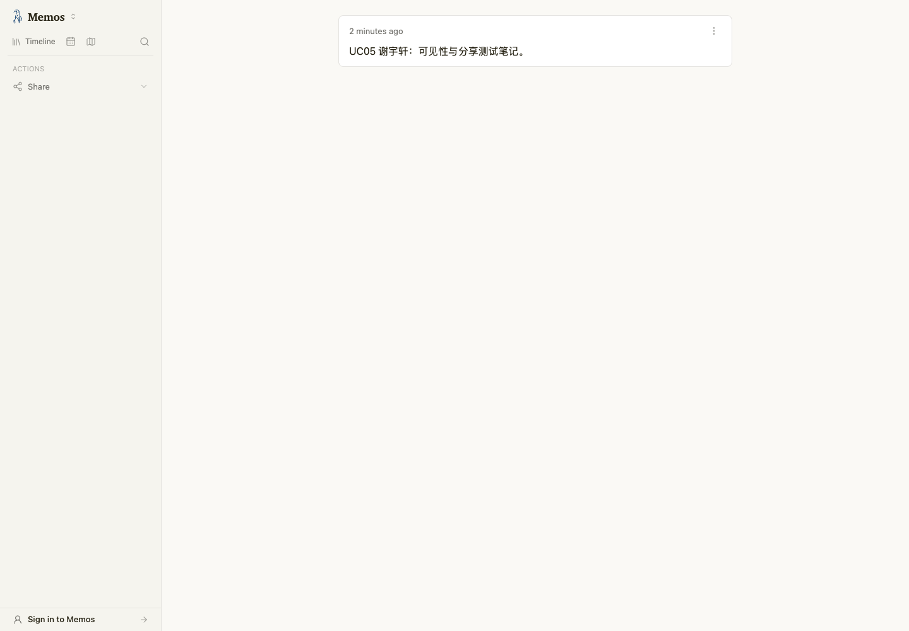
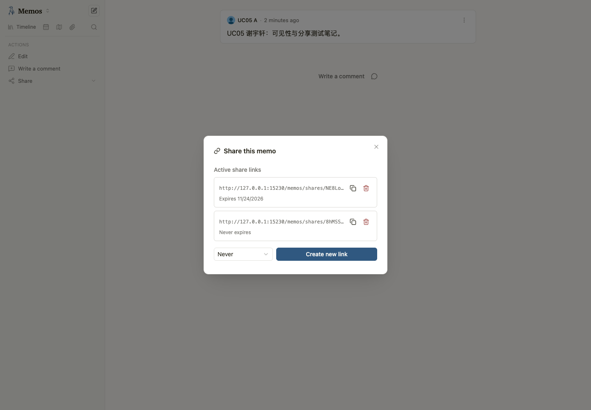
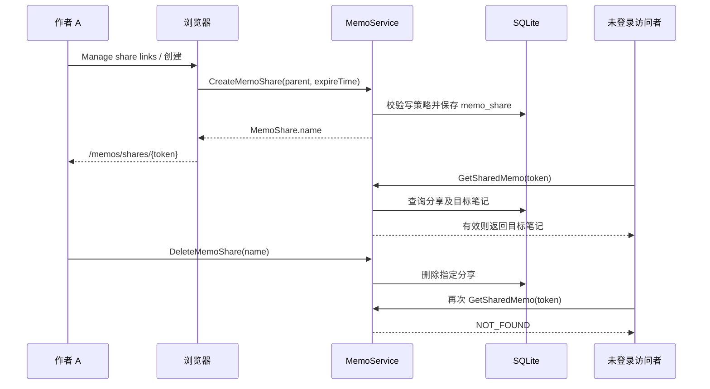

# UC-05 可见性与分享

| 项目 | 内容 |
| --- | --- |
| 负责人 | 谢宇轩 |
| 互审人 | 徐铭（已通过，据谢宇轩反馈） |
| 阅读与运行基线 | Memos 26.11.0，官方 macOS arm64 发行版 |
| 完整源码提交号 | `b40d8a7b573774c52b022c8d6537d6baf2129dc0` |
| 运行环境 | macOS 27.2.1 / arm64，SQLite，Microsoft Edge 无头浏览器，Playwright |
| 测试地址与日期 | `http://127.0.0.1:15230`，2026-11-24（UTC+8） |
| 当前状态 | 功能实测、源码分析、标注和维护候选完成；徐铭互审通过，待组长整合 |
| 组内截止时间 | 待组长确认 |

## 一、任务完成情况

- [x] 独立实例准备 A、B 两个普通账号，管理员另行标识。
- [x] 三个独立浏览器上下文核对本人、其他账号及未登录访问。
- [x] 验证 PRIVATE、PROTECTED、PUBLIC 及 SPACE 边界，记录实例公开/私有设置。
- [x] 区分普通地址与专门分享地址，验证分享、撤销、过期和越权。
- [x] 完成功能需求还原、请求与源码链路、要塞/雷区标注。
- [x] 提交质量观察、维护候选、阅读收获与可执行复验脚本。
- [x] 徐铭互审通过；据谢宇轩反馈，检查未发现需修改的问题。
- [ ] 张凯硕确认模块名称、组长汇总与最终发布。

本报告由工具辅助在本机独立实例中实测生成。测试结果不沿用其他成员截图；徐铭互审结论据谢宇轩于 2026-11-24 的反馈记录，其他组内会议及确认事项仍按实际进度填写。

## 二、功能与需求还原

| 项目 | 当前版本的实际行为 |
| --- | --- |
| 目标用户与角色 | 作者控制受众；其他普通用户读取被允许的笔记；未登录者通过允许匿名的公开笔记或有效专门分享链接读取；实例管理员具有按名称访问的特殊权限 |
| 业务目的 | 在个人私密记录、实例内交流、匿名公开和指定链接分享之间选择访问范围 |
| 操作入口 | 编辑器的受众菜单；详情页左栏 Share → Copy Link / Share as image / Manage share links；后者创建与撤销专门链接 |
| 前置条件 | 已初始化的实例；创建和更新需登录且有写权限；SPACE 需要有效空间及相应成员/管理员条件 |
| 输入 | 笔记正文、visibility、可选 space；分享可选 expireTime，界面提供永不过期、1/7/30 天 |
| 主要过程 | 作者创建或编辑受众并保存 → 不同会话访问普通地址；或管理分享链接 → 接收方使用令牌地址 → 作者撤销后重新访问 |
| 输出 | 返回相应笔记或权限错误；分享返回独立的 MemoShare 资源名，链接访问不修改原笔记的 PRIVATE 值 |
| 权限与异常 | PRIVATE 普通用户仅作者可读；PROTECTED 要求登录；PUBLIC 的匿名访问还受实例 access_mode 限制；SPACE 由空间成员资格控制；管理员按名称访问例外；无效、过期、已撤销的分享返回 404 |
| 关联模块 | 编辑器、React Query、Connect RPC / HTTP JSON Gateway、授权策略、Store 与 SQLite；附件的分享令牌传递与关联笔记授权需要单独处理 |

**普通地址**为 `/memos/{memoUID}`；Share 中的 Copy Link 复制该普通地址，并不产生新授权。**专门分享地址**为 `/memos/shares/{shareToken}`，由 Manage share links 创建。Share as image 是图片输出入口，不属于令牌访问授权。

本轮无空间放置时，编辑菜单实际显示 Private、Protected、Public 和 Add to space；SPACE 需有空间放置，不应作为无条件第四选项展示。API 另建只有 A 为成员的空间验证 SPACE 权限。

## 三、实际操作与证据

### 3.1 环境、角色与复验方法

使用官方发行包，SHA-256 为 `3bc92c7cd84aeefc71d601404b2a986309acb779309b8a5aaa34d3249609ffb5`，与[官方 26.11.0 发布资产](https://github.com/usememos/memos/releases/tag/26.11.0)一致。`/api/instance/profile` 返回的版本、提交号与文首一致。独立数据目录为工作区 `runtime/uc05-data`。

| 会话 | 实际账号 | 实例角色 | 用途 |
| --- | --- | --- | --- |
| 管理员 | uc05admin | ADMIN | 初始化、建立普通账号、切换实例访问模式、特殊权限对照 |
| A | uc05a | USER | 笔记作者；测试空间的空间 ADMIN，实例角色仍为 USER |
| B | uc05b | USER | 其他普通账号，非测试空间成员 |
| 匿名 | 无 | 未登录 | 单独 BrowserContext，无 A/B 登录 cookie |

正文样本为“UC05 谢宇轩：可见性与分享测试笔记。”。API 脚本在每次请求前指定预期状态，以断言检查实际响应；50 项状态断言全部通过。角色与原始请求/响应见 [uc05-requests.json](assets/uc05-requests.json)。密码及访问令牌只保存在归档目录外的本地运行目录，不进入交付文件。

创建初始管理员后由管理员明确创建两个 USER，避免把首个自动成为 ADMIN 的账号误作普通账号。

### 3.2 普通地址权限矩阵

下表为实际 HTTP JSON Gateway 状态码；200 表示返回样本正文。401/403 均未返回样本正文。测试中实例模式最终恢复为 PRIVATE。

| 实例访问模式 | 笔记受众 | A 作者 | B 其他普通用户 | 未登录 | 实例管理员 |
| --- | --- | --- | --- | --- | --- |
| PRIVATE | PRIVATE | 200 | 403 | 401 | 200 |
| PRIVATE | PROTECTED | 200 | 200 | 401 | 200 |
| PRIVATE | PUBLIC | 200 | 200 | 401 | 200 |
| PUBLIC | PUBLIC | 本轮不重复 | 本轮不重复 | 200 | 本轮不重复 |
| PUBLIC | PROTECTED | 本轮不重复 | 本轮不重复 | 401 | 本轮不重复 |
| PUBLIC | PRIVATE | 本轮不重复 | 本轮不重复 | 401 | 本轮不重复 |
| PRIVATE | SPACE（仅 A 为成员） | 200 | 403 | 401 | 200 |

预期来自 `CheckMemoReadContext`。实际模式切换使用 `PATCH /api/instance/settings/ACCESS`；普通笔记修改使用 `PATCH /api/memos/{uid}?updateMask=visibility`。SPACE 记录及成员列表见 [边界请求](assets/uc05-boundaries.json)。本轮未测 SPACE 邀请加入/退出、各数据库方言、并发撤销或附件二进制访问。

### 3.3 分享与异常验证

| 场景 | 操作与预期 | 实际结果与证据 |
| --- | --- | --- |
| 私有笔记的有效分享 | A 创建链接，A/B/匿名请求专门分享地址；预期均可读 | 三种身份均 200，原笔记仍 PRIVATE；[请求](assets/uc05-requests.json) |
| 越权创建/撤销 | B 针对 A 的笔记创建分享或删除 A 的分享 | 均 403；[请求](assets/uc05-requests.json) |
| 越权修改正文 | B PATCH A 的 PRIVATE 笔记 | 403；分享授权不提供笔记写权限 |
| 正常撤销 | A 删除指定 MemoShare；匿名重新请求相同令牌 | 删除 200，重新读取 404；普通地址仍按原可见性判断 |
| 无效令牌 | 匿名请求不存在的 shareToken | 404 |
| 过去的到期时间 | 创建时传入 2020 年 expireTime | 400；不生成分享 |
| 实际过期 | 创建约 3 秒后到期的分享，等待 4 秒后匿名请求 | 404；管理列表仍保留该条目，见维护候选 |
| SPACE 分享 | A 为 SPACE 笔记创建分享 | HTTP 400，RPC FailedPrecondition，拒绝创建 |
| 归档后分享 | 对另一个 PRIVATE 样本先建分享，再归档 | 旧分享读取 404；新建分享返回 HTTP 400 / FailedPrecondition |

HTTP Gateway 的 FailedPrecondition 在本环境映射为 400，勿误写成固定的 HTTP 412。详细 RPC code 与 message 保存在 JSON 中。

### 3.4 浏览器实测

使用三个独立 Edge BrowserContext，A/B 分别通过实际登录页登录，匿名会话从未登录。Playwright 点击真实详情页的 Share → Manage share links，在界面点击 Revoke 撤销链接，再用匿名上下文重新导航。截图为原始页面，没有修改界面结果。

| 证据 | 实际页面行为 |
| --- | --- |
| [A 本人访问](assets/uc05-a-private.png) | 可见样本正文及作者操作入口 |
| [B 普通地址](assets/uc05-b-denied.png) | 无权访问；界面未显示正文 |
| [匿名普通地址](assets/uc05-anon-normal.png) | 私有实例进入登录页 |
| [匿名专门分享](assets/uc05-anon-share.png) | 无需登录显示样本正文 |
| [管理分享面板](assets/uc05-share-panel.png) | 显示到期链接与永不过期链接，提供创建、复制、撤销按钮 |
| [撤销后匿名页面](assets/uc05-anon-revoked.png) | 私有实例最终进入登录页，原正文不再显示；API 对照为 404 |
| [受众菜单](assets/uc05-audience-options.png) | 显示 Private、Protected、Public、Add to space |

[浏览器文本与地址记录](assets/uc05-browser.json)保留最终 URL。浏览器的最终页面与 API 错误码需要分开记录，不能仅凭前端重定向认定服务端返回 401。





### 3.5 数据持久化及复验脚本

[SQLite 只读快照](assets/uc05-sqlite.json)核对 memo 的正文、visibility、row_status、space_id，以及 memo_share 的 memo_id、uid、expires_ts。它是 API 边界用例结束时的快照，早于最后一次浏览器复验，不作为最终浏览器撤销状态的证据。分享删除与过期读取以相应请求记录为准。

在工作区启动全新实例（每轮使用空数据目录，以免账号重名），安装 Python Playwright 并具备 Microsoft Edge 后，顺序执行：

```sh
./runtime/memos-26.11.0/memos --addr 127.0.0.1 --port 15230 --data ./runtime/uc05-data --config-apply off
# 另一个终端，工作区根目录：
./runtime/venv/bin/python teamwork/scripts/uc05_verify.py
./runtime/venv/bin/python teamwork/scripts/uc05_boundaries.py
./runtime/venv/bin/python teamwork/scripts/uc05_browser.py
```

`uc05_verify.py` 仅依赖 Python 标准库；`uc05_browser.py` 需要 Playwright，Edge 路径目前对应本机 macOS。该复验不要求 Go 编译工具链；本轮使用发行版验证，未执行上游 Go 测试套件。

## 四、功能与代码的对应关系

| 环节 | 实际文件、原始行号与固定链接 | 输入输出与职责 |
| --- | --- | --- |
| 编辑器受众 | [web/src/components/MemoEditor/edit/toolbar/AudienceMenu.tsx:29](https://github.com/usememos/memos/blob/b40d8a7b573774c52b022c8d6537d6baf2129dc0/web/src/components/MemoEditor/edit/toolbar/AudienceMenu.tsx#L29-L100) | AudienceMenu：菜单选择受众；编辑器保存时发送 visibility 字段。 |
| 详情与分享入口 | [web/src/components/MemoDetailSidebar/MemoDetailSidebar.tsx:112](https://github.com/usememos/memos/blob/b40d8a7b573774c52b022c8d6537d6baf2129dc0/web/src/components/MemoDetailSidebar/MemoDetailSidebar.tsx#L112-L155) | 判断分享管理入口是否可见；Copy Link 仅构造普通地址。 |
| 分享面板 | [web/src/components/MemoDetailSidebar/MemoSharePanel.tsx:87](https://github.com/usememos/memos/blob/b40d8a7b573774c52b022c8d6537d6baf2129dc0/web/src/components/MemoDetailSidebar/MemoSharePanel.tsx#L87-L165) | handleCreate / handleRevoke：可选到期时间、创建、复制与撤销。 |
| 请求与缓存 | [web/src/hooks/useMemoShareQueries.ts:24](https://github.com/usememos/memos/blob/b40d8a7b573774c52b022c8d6537d6baf2129dc0/web/src/hooks/useMemoShareQueries.ts#L24-L91) | useCreateMemoShare / useDeleteMemoShare / useSharedMemo；创建、删除后使列表缓存失效；getShareUrl 构造令牌地址。 |
| 详情路由处理 | [web/src/pages/MemoDetail.tsx:105](https://github.com/usememos/memos/blob/b40d8a7b573774c52b022c8d6537d6baf2129dc0/web/src/pages/MemoDetail.tsx#L105-L141) | 根据 params.token 分流 GetSharedMemo 与 GetMemo；分享模式使用只读展示。 |
| 普通访问 | [server/api/memo_service.go:239](https://github.com/usememos/memos/blob/b40d8a7b573774c52b022c8d6537d6baf2129dc0/server/api/memo_service.go#L239-L259) | GetMemo 查记录后调用 checkMemoReadAccess。 |
| 可见性更新 | [server/api/memo_service.go:287](https://github.com/usememos/memos/blob/b40d8a7b573774c52b022c8d6537d6baf2129dc0/server/api/memo_service.go#L287-L370) | UpdateMemo 校验字段掩码、写权限和 visibility/space 状态。 |
| 授权上下文 | [server/api/memo_access.go:17](https://github.com/usememos/memos/blob/b40d8a7b573774c52b022c8d6537d6baf2129dc0/server/api/memo_access.go#L17-L61) | 解析当前用户及实例匿名设置，转换授权决定为服务端错误。 |
| 授权核心 | [core/access/memo.go:93](https://github.com/usememos/memos/blob/b40d8a7b573774c52b022c8d6537d6baf2129dc0/core/access/memo.go#L93-L157) | CheckMemoReadContext 汇合作者、实例管理员、匿名设置、空间成员与分享特许。 |
| 分享服务 | [server/api/memo_share_service.go:25](https://github.com/usememos/memos/blob/b40d8a7b573774c52b022c8d6537d6baf2129dc0/server/api/memo_share_service.go#L25-L229) | 创建校验、独立分享记录、撤销、过期检查与精确笔记访问。 |
| 存储分享 | [store/db/sqlite/memo_share.go:12](https://github.com/usememos/memos/blob/b40d8a7b573774c52b022c8d6537d6baf2129dc0/store/db/sqlite/memo_share.go#L12-L187) | CreateMemoShare 在事务内复核写策略；插入 memo_share；DeleteMemoShare 删除指定记录。 |
| 存储可见性 | [store/db/sqlite/memo_attachment.go:191](https://github.com/usememos/memos/blob/b40d8a7b573774c52b022c8d6537d6baf2129dc0/store/db/sqlite/memo_attachment.go#L191-L220) | applyMemoUpdate 参数化更新 memo.visibility，与其他笔记字段一起保存。 |

### 4.1 调用过程

受众保存：AudienceMenu 更新编辑器草稿 → 保存层构造含 visibility 的 UpdateMemo 请求 → 服务端校验作者/管理员、空间约束和字段掩码 → Store 在事务和写策略约束下更新 SQLite → 返回新 Memo，前端更新查询缓存。

普通读取：详情路由使用笔记 UID 发 GetMemo → Store 查到笔记 → buildMemoReadContext 解析查看者、实例匿名开关和空间信息 → CheckMemoReadContext 返回授权决定 → 转换为笔记或 401/403/404。列表使用数据库访问范围谓词，管理员的按名称特权不能直接推导为列表暴露所有私有记录。

专门分享：面板发 CreateMemoShare → 校验可管理权限、活动状态、非 SPACE 受众及未来到期时间 → 生成随机令牌并保存 memo_share → getShareUrl 构造专门地址。匿名路由发 GetSharedMemo → 验证令牌存在且未过期 → 核对笔记仍活动且非 SPACE → 以精确的 memo ID 授权 → 返回只读展示所需数据，并清空 parent，防止把授权沿关联扩散。撤销删除分享记录，后续请求无法再解析令牌。



## 五、代码标注

### ANN-UC05-01 要塞：分享授权限定到一条有效笔记

原文件 `server/api/memo_share_service.go`，函数 `GetSharedMemo`，原始 172–188 行。令牌校验通过后仍需复核笔记生命周期与受众，再把分享记录绑定的 memo ID 传入授权上下文。该检查保证旧分享不能继续读取归档笔记，也不能共享 SPACE 受众。

[server/api/memo_share_service.go:172](https://github.com/usememos/memos/blob/b40d8a7b573774c52b022c8d6537d6baf2129dc0/server/api/memo_share_service.go#L172-L188)

```go
func (s *APIService) GetSharedMemo(ctx context.Context, request *apipb.GetSharedMemoRequest) (*apipb.Memo, error) {
// 谢宇轩 UC-05：先验证令牌存在且未过期；错误立即返回。
	ms, err := s.getActiveMemoShare(ctx, request.ShareToken)
	if err != nil {
		return nil, err
	}

// 谢宇轩 UC-05：按分享记录绑定的 ID 查笔记，访问者不能另选目标。
	memo, err := s.Store.GetMemo(ctx, &store.FindMemo{ID: &ms.MemoID})
	if err != nil {
		return nil, status.Errorf(codes.Internal, "failed to get memo")
	}
	// Treat archived or missing memos the same as an invalid token — no information leakage.
// 谢宇轩 UC-05：归档、缺失和 SPACE 均按不可用处理。
	if memo == nil || memo.RowStatus != store.Normal || memo.Visibility == store.SpaceAudience {
		return nil, status.Errorf(codes.NotFound, "not found")
	}
// 谢宇轩 UC-05：精确 ID 进入统一授权策略；不会把分享扩展到任意笔记。
	readContext, err := s.buildMemoReadContext(ctx, memo, &ms.MemoID)
	if err != nil || !access.CheckMemoReadContext(readContext).Allowed() {
		return nil, status.Error(codes.NotFound, "not found")
```

验证对应“有效分享 200”“已撤销/过期 404”“归档分享 404”。这是一处关键防护，不等同于实现了关联、附件、空间并发等所有情形的完整实测覆盖。

### ANN-UC05-02 雷区：PRIVATE 仍可被独立分享授权读取

原文件 `core/access/memo.go`，函数 `CheckMemoReadContext`，原始 113–122 行。这属于已实测的设计边界：在进入 PRIVATE/PROTECTED/PUBLIC 的分支前，精确匹配的分享授权已经可以放行。把笔记设为 PRIVATE 不等于撤销既有分享；要终止该访问路径，需要撤销对应链接或等待到期。管理员按名称访问另有提前放行分支（109–111 行），也应与普通用户测试分开。

[core/access/memo.go:113](https://github.com/usememos/memos/blob/b40d8a7b573774c52b022c8d6537d6baf2129dc0/core/access/memo.go#L113-L122)

```go
// 谢宇轩 UC-05：作者判断要求账号活动；归档且非作者先返回不可见。
	viewerActive := IsActiveUser(ctx.Viewer)
	viewerIsAuthor := viewerActive && ctx.Viewer.ID == memo.CreatorID
	if memo.RowStatus == store.Archived && !viewerIsAuthor {
		return MemoReadDecision{Denial: MemoReadDenialNotFound}
	}

// 谢宇轩 UC-05：分享只适用于绑定的笔记 ID，并明确排除 SPACE。
	shareApplies := ctx.SharedMemoID != nil && memo.ID == *ctx.SharedMemoID && memo.Visibility != store.SpaceAudience
// 谢宇轩 UC-05：该放行发生在下面的 visibility switch 之前，PRIVATE 也可经有效分享读取。
	if shareApplies {
		return MemoReadDecision{Class: MemoReadClassPrivate}
	}
```

已有保护包括目标 ID 精确匹配、非 SPACE 限制、上游令牌过期/生命周期验证和不沿关系继承权限。当前观测不构成私有权限绕过缺陷；它是显式分享入口授予的独立只读访问路径。

## 六、质量观察与维护候选

| 项目 | 内容 |
| --- | --- |
| 候选名称 | 分享管理面板区分有效与已过期链接 |
| 提出人 | 谢宇轩，2026-11-24 |
| 当前事实与证据 | 创建约 3 秒到期链接，4 秒后 GetSharedMemo 返回 404；ListMemoShares 仍返回该记录，面板把它列在 Active share links 下，并保留复制按钮。见请求记录 expired-share / list-shares-includes-expired 与分享面板截图 |
| 源码解释 | ListMemoShares 按 memo_id 列全部记录；SQLite 查询没有到期条件；前端直接 shares.map，formatExpiry 仅格式化日期，不标记已过期 |
| 观察类型 | 易用性与状态表达问题；服务端到期控制实测有效 |
| 影响对象 | 管理长期分享链接的作者，可能复制已经不可用的链接；本次不估计发生频率 |
| 目标行为 | 将到期条目标记为“已过期”并归入单独区域；不可用链接禁用复制，但保留撤销/清理入口；有效链接仍显示到期信息 |
| 边界 | 无到期字段保持有效；过去到期时间显示失效；列表为空有清晰提示；打开期间跨越到期时刷新状态；删除失败保留原条目并反馈错误 |
| 权限约束 | 不改变服务器授权、expireTime 语义或既有分享数据；不让非作者获得管理权 |
| 涉及模块 | MemoSharePanel.tsx、useMemoShareQueries.ts、国际化文案、前端状态测试；优先前端分类，保持 API 兼容 |
| 检查条件 | 永久、未来、过去三类链接均显示准确；过去链接匿名读取仍为 404；复制/撤销行为正确；键盘与屏幕阅读器可辨别状态 |
| 成本与风险 | 局部前端变更，无数据库迁移；需统一客户端与服务器时间偏差的处理，不将界面状态视为授权依据 |
| 状态 | 已提出，待组内评审，未分配 MNT 编号，未实现 |

另一个源码与界面的观察是 Public 菜单文案“Anyone, even signed out”未表达私有实例对匿名访问的限制；本轮 PRIVATE 实例下 PUBLIC 普通访问仍为 401。可作为受众说明的后续讨论项，不与本次主维护候选合并为一个实现范围。

## 七、阅读收获与待核实问题

| 类型 | 内容 | 依据/后续 |
| --- | --- | --- |
| 阅读收获 | 实例公开开关、笔记受众、空间成员、管理员与分享令牌共同参与判定 | core/access/memo.go；复现必须显式记录每个维度 |
| 阅读收获 | 普通地址复制不增加权限；专门分享链接是独立授权记录 | getShareUrl 与 CreateMemoShare；演示时展示两个不同路径 |
| 阅读收获 | 前端页面重定向不能代替服务端返回码证据 | 浏览器撤销后登录页与 API 404 分别记录 |
| 阅读收获 | 不能只相信函数注释 | 分享服务的“Only the memo's creator”注释未覆盖 CanManageMemo 的管理员例外；本次管理员普通读取实测，管理员创建/撤销分享仅源码确认 |
| 待核实 | 团队最终数据库和操作系统 | 当前只实测 SQLite / macOS；如换 MySQL/PostgreSQL 需复验 |
| 待核实 | 附件二进制、关联笔记隔离、并发撤销、已打开页面的缓存展示 | 已定位相应源码，但本轮不声称实测通过 |
| 待核实 | 模块命名、截止日期与维护入选项 | 张凯硕及组长确认 |

## 八、互审与交付记录

| 互审人 | 日期 | 问题 | 修正结果 | 是否通过 |
| --- | --- | --- | --- | --- |
| 徐铭 | 2026-11-24 记录（据谢宇轩反馈） | 检查未发现问题 | 无需修正 | 通过 |

互审重点包括：①两个普通账号的角色；②同一 PRIVATE 笔记普通地址拒绝、分享地址允许、撤销后拒绝；③源码固定链接与原始行号，并核对已过期链接维护候选。

本轮交付包含本页 Markdown、7 张原始截图、接口/浏览器/SQLite 记录、三个复验脚本。本页与证据归档于团队仓库，Wiki 同步展示，归档路径为 `docs/phase-1/uc-05-sharing.md`。组长汇总文字见同目录 `uc05-summary-for-leader.md`。
