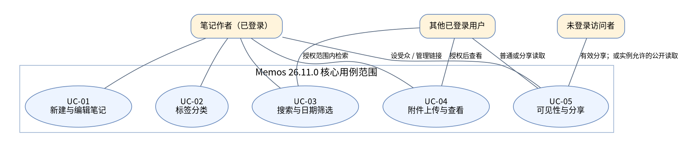
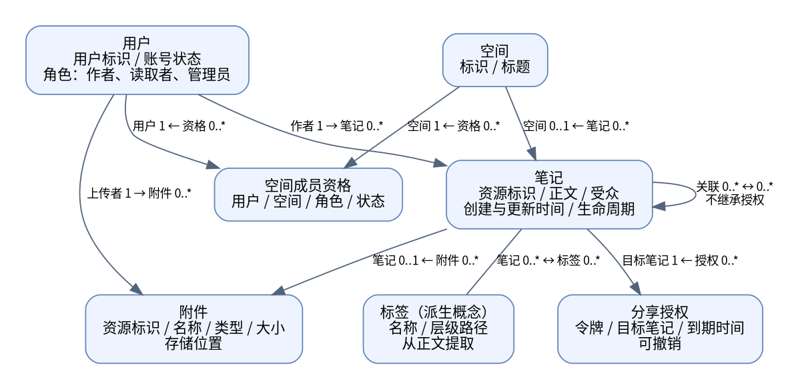

# 系统用例与概念模型整合

**模型整合：张凯硕**  
**版本：26.11.0；上游提交：b40d8a7b573774c52b022c8d6537d6baf2129dc0**  
**更新日期：2026-11-28**

本文整理第二阶段的系统用例与概念模型。职责是统一术语、系统边界及概念关系；各UC的用例规约、顺序图和实测由各负责人分别维护。

## 1. 系统用例图

图中连线表示参与者与用例关联，不表示不附条件的权限。作者的操作仍需登录、写策略及空间权限；其他用户检索和查看只限可访问对象；访客不能编辑笔记或管理分享。PUBLIC普通读取同时受实例访问模式约束，有效专门分享是独立只读授权路径。

UC-04在上传时创建附件资源，保存笔记时绑定；UC-05包含设置受众、管理分享和读取授权内容。本图保留团队既定五个UC边界，不把内部API函数另编成用户用例，也不把“按标签筛选”错误地作为所有正文搜索的必经步骤。

## 2. 系统概念类图

本图是业务概念模型，上一阶段的[数据对象图](../phase-1/deployment-architecture.md)描述具体表与字段。标签是正文派生概念，允许出现在概念类图中，但不对应独立tag表。附件在绑定之前可没有笔记；每条分享授权指向一个目标笔记；关联笔记不自动继承访问授权。空间成员资格是一种关联概念，承担用户、空间、角色和状态信息。

## 3. 术语统一

| 统一名称 | 含义与代码对应 | 容易混淆的说法 |
| --- | --- | --- |
| 笔记作者 | memo.creator_id对应用户；有管理权限者还可能包括管理员 | “当前用户”不总是作者 |
| 受众/可见范围 | PRIVATE、PROTECTED、PUBLIC、SPACE | PUBLIC并非在任何实例模式下都允许匿名 |
| 普通地址 | 按笔记UID读取，走GetMemo与普通访问策略 | Copy Link不创建分享授权 |
| 专门分享链接 | memo_share令牌，走GetSharedMemo | 设置PRIVATE不等于撤销既有分享 |
| 附件资源 | 数据库元数据及存储位置的统一资源 | SQLite不意味着文件字节存进数据库 |
| 附件内容 | LOCAL文件、DATABASE Blob或S3对象的字节 | GetAttachment元数据不等于内容路由 |
| 标签 | 正文派生的payload.tags | 无独立tag表不等于无标签业务概念 |
| 日期筛选 | 按选择的时间字段和浏览器日历日转换区间 | 不可将UTC字段提取与本地日区间混为一谈 |
| 概念关系 | 业务对象关联及基数 | 不等同于数据库声明的外键 |

## 4. 模型与五条流程的对应

| 用例 | 主要概念 | 边界检查 |
| --- | --- | --- |
| UC-01 | 用户、笔记、附件、笔记关联 | 保存包含数据更新及关系调整 |
| UC-02 | 笔记、标签 | 标签由正文派生，筛选结果受访问范围限制 |
| UC-03 | 用户、笔记、标签 | 查询条件与访问条件共同作用 |
| UC-04 | 用户、笔记、附件 | 上传、绑定和文件读取分阶段 |
| UC-05 | 用户、笔记、分享授权、空间与成员资格 | 普通访问、空间范围、显式令牌授权分开 |

## 5. 证据与整合状态

模型依据固定提交中的`core/access/memo.go`、`server/api/memo_share_service.go`、`server/api/memo_attachment_service.go`、`core/memopayload/runner.go`及`store/migration/sqlite/LATEST.sql`，固定链接均见[架构证据索引](../phase-1/deployment-architecture.md)。

系统用例图、概念类图及统一术语已形成。各成员局部规约与顺序图、正式维护项和教师需求模板的合稿仍保留原负责人职责；本页不将其标为完成。图示PNG和可编辑DOT源码与第一阶段图示共同保存在`docs/phase-1/assets/`。
